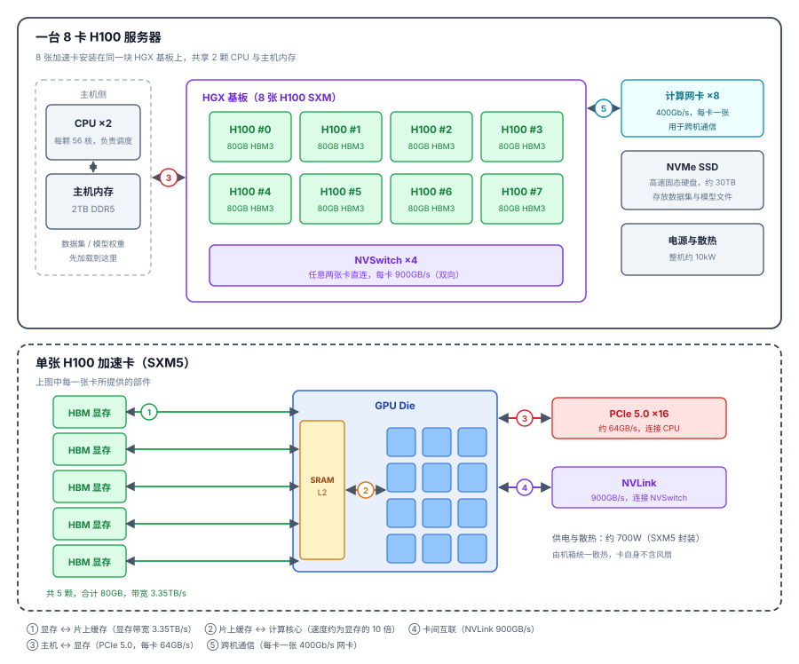

## 引子

`公元2026年1月1日，距离中国 Nvidia GPU 资源完全枯竭还有3650天。为了解决算力危机，中国组建了国产芯片探索舰队"算力号"，去寻找传说中由神秘光刻机看守的无尽算力。`

在上半年，团队一直在想办法通过租用各家 GPU 云服务来解决研发过程中的算力问题。这段时间接触了各种 AI 算力芯片，包括 GPU（A100，H20），NPU（910系列），PPU（810系列）等。我是芯片领域的纯外行，因此本文所有内容都只从使用者的视角出发，记录这些算力芯片的基本概念和信息。

## 算力芯片基础

首先"芯片"基本相当于[集成电路](https://zh.wikipedia.org/wiki/集成电路)（IC, Integrated Circuit）；把晶体管、电阻、电容等电子元器件，用半导体工艺（如光刻、刻蚀等）集成在一小块硅片上，封装起来能完成某种电路功能；芯片从功能上大致可以分为六大类：

| 类别 | 功能 | 典型产品 |
|---|---|---|
| **处理器芯片** | 执行计算与逻辑判断：运行操作系统、调度任务、执行程序指令 | [CPU](https://zh.wikipedia.org/wiki/中央处理器)、[GPU](https://zh.wikipedia.org/wiki/图形处理器)、[NPU](https://en.wikipedia.org/wiki/Neural_processing_unit)、[MCU](https://zh.wikipedia.org/wiki/微控制器) |
| 存储芯片 | 保存程序和数据：DRAM 断电即失（运行内存），Flash 断电保留（长期存储），HBM 为 AI 芯片提供超高带宽的数据供给 | [DRAM](https://zh.wikipedia.org/wiki/动态随机存取存储器)（内存）、[NAND Flash](https://zh.wikipedia.org/wiki/闪存)（SSD）、[HBM](https://en.wikipedia.org/wiki/High_Bandwidth_Memory) |
| 模拟芯片 | 处理现实世界连续变化的电压/电流信号：电源转换与稳压、信号放大、模拟与数字信号之间的相互转换（ADC/DAC） | 电源管理 [PMIC](https://en.wikipedia.org/wiki/Power_management_integrated_circuit)、[运放](https://en.wikipedia.org/wiki/Operational_amplifier)、[ADC](https://en.wikipedia.org/wiki/Analog-to-digital_converter)/[DAC](https://en.wikipedia.org/wiki/Digital-to-analog_converter) |
| 射频芯片 | 把数字信号调制成无线电波发射出去、再接收还原：手机信号、WiFi、蓝牙、GPS 都靠它 | [功放](https://en.wikipedia.org/wiki/RF_power_amplifier)、[滤波器](https://en.wikipedia.org/wiki/Electronic_filter)、[基带](https://en.wikipedia.org/wiki/Baseband_processor) |
| 传感器芯片 | 把物理世界的光、声、运动、温度等转换成电信号 | [图像传感器](https://en.wikipedia.org/wiki/Image_sensor)、[陀螺仪](https://en.wikipedia.org/wiki/Gyroscope)、[麦克风](https://en.wikipedia.org/wiki/Microphone) |
| 功率半导体 | 控制大电流、高电压的通断与转换，决定电能利用效率，是电动车、快充、光伏的核心 | [MOSFET](https://en.wikipedia.org/wiki/MOSFET)、[IGBT](https://en.wikipedia.org/wiki/Insulated-gate_bipolar_transistor)、碳化硅 [SiC](https://en.wikipedia.org/wiki/Silicon_carbide) |



除了按功能划分，芯片还有其他常见的分类维度：

- **按应用场景**：消费级（手机、家电）、工业级、车规级（需通过 [AEC-Q100](https://en.wikipedia.org/wiki/AEC-Q100) 认证，要求高可靠、宽温、长寿命）、军工/宇航级。常说的"车端芯片""机器人芯片"就是这个维度——它们不是新的功能类型，内部仍由上面六类功能芯片组合而成，只是按场景做了专门设计。
- **按信号类型**：数字芯片（处理 0/1 逻辑，如 CPU、存储）、模拟芯片（处理连续信号）、数模混合芯片（两者兼有，如 ADC、手机 SoC 里的射频部分）。
- **按制程工艺**：先进制程（7nm、5nm、3nm，用于 CPU、GPU、手机 SoC 等追求性能的芯片）、成熟制程（28nm 及以上，模拟、功率、MCU 大量使用）。经常提到的芯片"卡脖子"技术主要卡在先进制程上。
- **按集成形态**：单颗功能芯片、[SoC](https://zh.wikipedia.org/wiki/单片系统)（系统级芯片，把 CPU、GPU、基带等集成在一颗芯片上，如手机处理器）、[Chiplet](https://en.wikipedia.org/wiki/Chiplet)（芯粒，把多个小芯片拼装封装，如 AMD 锐龙、NVIDIA B200）。



算力芯片属于处理器芯片，是一种专门面向 AI 计算（矩阵运算）优化的芯片。这里举例目前国内外的算力芯片：GPU（NVIDIA），NPU（华为），TPU（Google），PPU（阿里），BPU（地平线）。尽管各家的架构设计和软件生态有所不同，算力芯片的基本组成是相同的，核心部件如下：

- **计算核心**：芯片的主体，成千上万个小计算单元（NVIDIA 叫 [CUDA Core](https://en.wikipedia.org/wiki/CUDA) / [Tensor Core](https://www.nvidia.com/en-us/data-center/tensor-cores/)，华为叫 [AI Core](https://www.hiascend.com/doc_center/source/zh/canncommercial/5046/operatordev/tbedevg/tbedevg_000009.html)）。
- **显存（[HBM](https://en.wikipedia.org/wiki/High_Bandwidth_Memory)，高带宽内存）**：堆叠在计算核心旁边的高速内存，负责存放模型参数和中间计算结果。
- **片上缓存（[SRAM](https://en.wikipedia.org/wiki/Static_random-access_memory) / Cache）**：位于计算核心与显存之间的高速缓存，容量只有几十 MB，读写速度约为显存的 10 倍，用于暂存计算核心当前正在使用的数据。
- **互联接口**：芯片与其他部件通信的接口。与 CPU 之间使用 [PCIe](https://zh.wikipedia.org/wiki/PCI_Express)，与其他加速卡之间使用专用高速互联（NVIDIA 的 [NVLink](https://en.wikipedia.org/wiki/NVLink)、华为的自研互联）。多卡训练需要频繁同步数据，互联带宽越高，同步耗时越短。

这些部件通过先进封装技术（如台积电 [CoWoS](https://zhuanlan.zhihu.com/p/1890075894934132607)）集成在同一块基板上，再配上供电和散热，就构成了一张完整的加速卡。为了方便理解，下面以 H100 为例，说明算力芯片的基本组成以及每个组成之间的关系。

<figure>
  
  <figcaption>一台 8 卡 H100 服务器与单张 H100 卡的组成。点击图片可放大查看。</figcaption>
</figure>

其他型号算力芯片的结构（拓扑结构、通信协议等）一般会有较大差异，但是在设计时需要考虑的核心部件以及交互关系是一致的。这些核心部件的效率/容量/性能、部件之间通路的速度，是评估一块算力芯片性能的主要考虑因素。

### 算力芯片的性能指标

为了方便理解，把国内外介绍算力芯片时通常会提到的指标，以及每个指标对应的部件或通路，整理如下表：

| 指标 | 定义与单位（含典型数值） | 涉及的部件或通路 | 其他信息 | 影响因素 |
|---|---|---|---|---|
| **峰值算力** | 每秒完成的运算次数，TFLOPS / TOPS；不同精度对应不同峰值，如 H100 FP16 989 TFLOPS、FP8 1979 TFLOPS | GPU Die 内的计算核心阵列 | 属于理论峰值，实际达成率无法到 100% | 核心数量、架构、运行频率；精度越低标称值越高 |
| **显存容量** | 单卡可用的显存总量，GB；H100 80GB、H20 96GB、昇腾 910B 64GB | HBM 的总容量 | 容量不足时装不下模型，出现 OOM | 颗粒数与单颗容量；封装可容纳的堆叠数（受 CoWoS 限制） |
| **显存带宽** | 显存与片上缓存之间每秒可搬运的数据量，GB/s 或 TB/s；H100 3.35TB/s、H20 约 4.0TB/s | 通路 ①（显存 → 片上缓存） | 带宽过低导致算力利用率低，加大 batch 也无效 | HBM 代际、堆叠数、位宽；与算力之比约 3.4GB/s per TFLOPS |
| **片上缓存容量** | Die 内 SRAM 的容量，MB；H100 的 L2 约 50MB | SRAM | 工作集超出容量时数据反复回显存，表现为带宽够但实际很慢 | 工艺与芯片面积决定容量上限；分块策略与工作集大小影响实际效果 |
| **互联带宽** | 卡间与跨机的通信速率，GB/s；NVLink 每卡 900GB/s（通路 ④）、400Gb/s 网卡约 50GB/s（通路 ⑤） | 通路 ④：NVLink、NVSwitch等；通路 ⑤：网卡 | 带宽低时通信占比升高，多卡扩展低于线性 | NVLink 链路数与速率、交换拓扑、网卡速率；并行策略决定走哪条通路 |

算力芯片的整体表现会有木桶效应，最弱的部件或通路会限制整体性能。国内芯片往往会出现类似的问题，比如看着峰值算力很高，但是显存带宽过低，导致实际的利用率很低。除了以上指标，功耗与软件生态也是重要的参考因素：功耗过高会抬高供电和散热成本，而软件生态（编程接口、算子库与框架适配）会直接影响使用体验。

在不同 AI 模型训练场景中，关注的指标不同；如果是一个单卡训练场景，因为不涉及卡间和跨机通信，主要关注显存带宽、峰值算力和显存容量这些因素。如果涉及单机分布式训练（FSDP、SP、TP 等技术），还需要关注互联带宽。如果涉及多机多卡训练，则还需要关注跨机互联带宽。

### 国内外芯片的性能对比

下表按单卡规格整理，峰值算力取 FP16 稠密值；此表仅做参考，不构成任何建议。

| 型号 | 峰值算力 | 显存容量 | 显存带宽 | 规格来源 |
|---|---|---|---|---|
| [H100 SXM](https://www.nvidia.com/en-us/data-center/h100/) | 989 TFLOPS | 80GB | 3.35TB/s | NVIDIA 官方 |
| [H200 SXM](https://www.nvidia.com/en-us/data-center/h200/) | 989 TFLOPS | 141GB | 4.8TB/s | NVIDIA 官方 |
| [B200](https://www.nvidia.com/en-us/data-center/dgx-b200/) | 约 2,250 TFLOPS | 192GB | 8TB/s | NVIDIA 官方 |
| [A100 80GB SXM](https://www.nvidia.com/en-us/data-center/a100/) | 312 TFLOPS | 80GB | 2.0TB/s | NVIDIA 官方 |
| [H20](https://flopper.io/gpu/nvidia-h20-96gb) | 148 TFLOPS | 96GB | 4.0TB/s | 公开资料 |
| [昇腾 910B](https://mirrorfrog.com/docs/cards/huawei/ascend-910b/) | 约 320 TFLOPS（子版本 192–320） | 64GB | 600GB/s–1.2TB/s | 公开资料 |
| [昇腾 910C](https://www.huawei.com/cn/news/2025/9/hc-xu-keynote-speech) | 800 TFLOPS | 128GB | 3.2TB/s | 华为官方口径 |
| [真武 810E](https://www.t-head.cn/product?id=7) | 官方未公布 | 96GB | 2.7TB/s | 平头哥官方 |
| [RTX 4090](https://www.nvidia.com/en-us/geforce/graphics-cards/40-series/rtx-4090/) | 82.6 TFLOPS | 24GB | 1.0TB/s | NVIDIA 官方 |

> RTX 4090 是消费级显卡，显存小、没有 NVLink，适合单机小模型推理。真武 810E 只公布了显存与带宽，昇腾 910B 的四个子版本算力跨度很大。

## Memory Bound 与 Compute Bound

做算子优化时，常会遇到 Memory Bound 与 Compute Bound 这两个概念，用来回答一个问题：算子跑得慢，到底卡在计算单元（计算核心），还是卡在数据搬运（显存带宽）。两种瓶颈的优化方向是相反的——算力受限时优化计算效率，带宽受限时优化数据复用。

理论上，判断一个算子是 Memory Bound 还是 Compute Bound，主要是拿算子的**计算强度**与芯片的算力带宽比做比较。计算强度是算子完成的运算量（FLOP）与访问的数据量（Byte）之比，单位是 FLOP/Byte。把它和硬件的"算力带宽比"比较，以 H100 为例：FP16 峰值约 989 TFLOPS、显存带宽 3.35TB/s，比值约为 295 FLOP/Byte。计算强度高于这个值，说明数据供给跟得上、计算单元是瓶颈，属于 Compute Bound；低于这个值，说明计算单元在等数据，属于 Memory Bound。

但是在实际工程中，理论判据很难算准：标称峰值常带稀疏加速的前提，实际频率又受功耗和温度影响，融合算子、reduction 这类算子的实际访存也和公式对不上。所以一般不手算比值，直接用工具实测，参考资料如下：

- [Nsight Compute 性能分析指南](https://docs.nvidia.com/nsight-compute/ProfilingGuide/index.html)：Speed of Light 面板看 Compute (SM) 与 Memory 的吞吐占比，Roofline 面板把实测点画到屋顶图上。
- [CUDA C++ 最佳实践指南](https://docs.nvidia.com/cuda/cuda-c-best-practices-guide/index.html)：计算强度与访存优化的基础说明。
- [Roofline 原始论文](https://dl.acm.org/doi/10.1145/1498765.1498785)：计算强度与屋顶模型的出处。

再补充几条训练与推理场景的结论：

- **训练一般偏 Compute Bound**：矩阵乘法这类算子数据复用率高，batch 又大，一次加载的数据能参与大量运算，计算强度通常高于硬件的算力带宽比。
- **推理（尤其是逐 token 生成）偏 Memory Bound**：每生成一个 token 都要把模型权重完整读一遍，对应的矩阵计算量很小，计算强度远低于阈值。这也是推理场景下显存带宽比峰值算力更关键的原因。
- 大模型推理中的 prefill 阶段会并行处理整段输入，计算强度明显上升，接近 Compute Bound；decode 阶段则稳定在 Memory Bound。

## 常见问题

**为什么国内算力芯片在制造环节长期落后？**

这不是单点差距，而是历史债务堆积的结果。先进制程依赖 [EUV 光刻](https://zh.wikipedia.org/wiki/极紫外光刻)，设备受出口管制，国内只能用 DUV 多重曝光做 7nm 级，成本和良率都不如国外先进水平；HBM 长期由三星、SK 海力士、美光主导，国产 HBM 起步晚、技术滞后；更大的问题是先进封装（CoWoS）产能集中在台积电，国内自建产能还在爬坡，能拿到的份额有限。产能不足又直接拖慢研发节奏：一次流片要排队等产能，从设计定稿到拿到样片、再到下一轮改版，周期被拉得很长，试错次数少，迭代自然就慢。再往上还有 EDA 工具、IP 核和软件生态的差距。

> “安得算力千万台，大庇中国智能俱欢颜”

**标称算力很高，为什么实际训练还是慢？**

峰值算力只是计算单元的理论上限，实际训练还受显存带宽、互联带宽和软件栈（算子库覆盖度、通信库效率、框架适配）制约。国内一些芯片峰值数字好看，显存带宽和软件适配却是短板，实际利用率（MFU）可能只有标称值的很小一部分。

**一张卡能跑多大的模型？**

推理时，权重占用约等于参数量 × 每个参数的字节数：FP16 约 2GB/十亿参数，INT8 约 1GB；此外还要留出 KV Cache（随上下文长度和 batch 增长）和框架开销。训练还要存梯度、优化器状态和激活值，通常是权重的数倍。装不下时可用张量并行、流水并行，或把部分数据放到主机内存，代价是额外的通信开销和速度损失。

**国产卡能直接跑 CUDA 代码吗？**

多数卡通过兼容层或迁移工具支持，但并非零成本：冷门算子可能缺失，性能调优要重做。选型时最好先用自己的模型做一轮迁移和性能验证。

## 结语

这篇只覆盖了使用者需要的最小集合：芯片的基本分类、一张算力卡的组成与数据通路、几个关键指标，以及如何判断算子受限于算力还是带宽。本文没有逐个介绍各型号的芯片设计与拓扑结构，只用 H100 做了一次统一参照；具体型号在互联方式、指令集和微架构上的差异，留到以后再说。希望这篇能帮到刚接触算力采购和模型部署的同学，少被标称数字误导。文中内容基于公开资料和实际使用经验，错漏难免，欢迎指正；也感谢上半年折腾集群和算力申请的同事。

