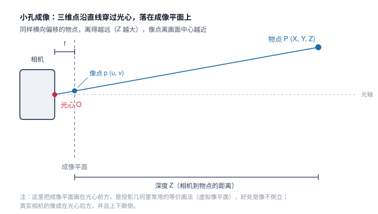
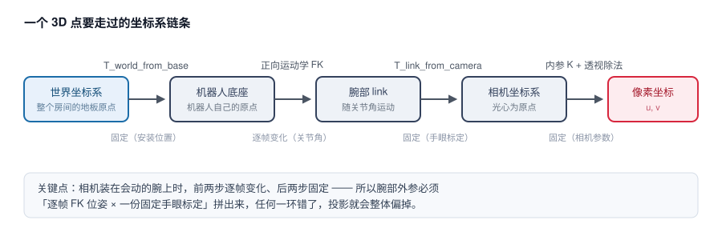
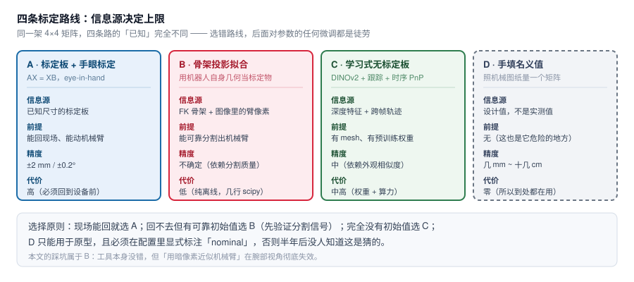
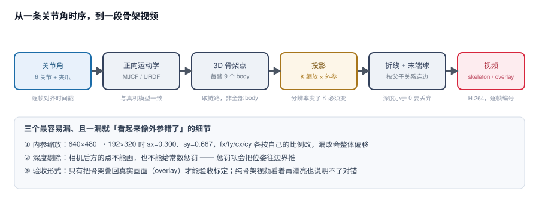

## 引子

最近在处理机器人采集数据。每条轨迹有头部相机加左右两个腕部相机，三个视角同时拍同一段操作。我们想做的事很简单：把机器人的骨架（关节连线，也就是一串 3D 点）画到这三张图上，做成给视频生成模型用的控制信号。

听起来是「有 3D 点、有相机参数，投一下就行」。但实际做的时候，头部视角一投就准，两个腕部视角怎么调都对不上——骨架像浮在半空，跟真实的机械臂差着大半个画面。

这篇文章把这套东西从零讲一遍：坐标系是什么、内参外参各管什么、为什么相机装在会动的腕上就变复杂了，最后复盘那次排查。不需要任何前置知识。

## 一句话版本

一个 3D 点变成图片上的一个像素，只做两件事：

1. **把它搬到相机眼前**——换坐标系（外参）
2. **按「近大远小」压到平面上**——透视除法 + 缩放（内参）

后面所有的公式、矩阵、标定，都是为这两件事服务的。

## 一、坐标系：先给场景发一张「地址簿」

### 为什么需要坐标系

问「杯子在哪」，答案必须是相对的：在桌子中间、在我左手边。**坐标系就是一套参照系**：指定一个原点，再指定三条互相垂直的轴，任何一个点就能用三个数字 (x, y, z) 精确描述。

- 房间的墙角可以当原点，地板两条边当 x、y 轴，垂直向上当 z 轴。那么「桌子中心」可能是 (1.2, 0.8, 0.75)，单位米。
- 换一个原点（比如以桌子中心为原点），同一个杯子就变成另一组数字。

**点的位置没有变，变的是描述方式。**

### 为什么需要「世界坐标系」

机器人系统里有好几套坐标系同时在用：

| 坐标系 | 原点在哪 | 谁在用 |
|---|---|---|
| 世界 | 场景里某个固定点（常取机器人底座中心在地面的投影） | 相机、机器人、物体，全部统一到这个「公共语言」 |
| 机器人底座 | 机器人自己安装的地方 | 机器人自身的运动学 |
| 关节 / 连杆 | 每一节机械臂 | 计算姿态 |
| 相机 | 相机光心 | 投影计算 |

**世界坐标系的作用就是「统一货币」**：每个相机、每个物体、每条机械臂都各自说自己坐标系里的话，但要比较、要投影，就得先换算成同一种语言。所以大家都把自己的位置写成「我在世界坐标系里的哪儿」。

### 怎么在两套坐标系之间换算

只有两件事：**旋转**和**平移**。

```text
P_另一套 = R @ P_原来 + t
```

- R 是 3×3 旋转矩阵（描述两套坐标系的轴朝向差多少）
- t 是 3 维平移向量（描述原点差多远）

工程上习惯把这两件事合成一个 4×4 矩阵，叫**齐次变换矩阵**：

```text
T = | R  t |        P_h = | x |
    | 0  1 |              | y |
                           | z |
                           | 1 |
```

多出来的一维（那个 1）纯粹是为了让「先旋转再平移」能用一次矩阵乘法写完。连着换好几套坐标系，就是把几个 T 矩阵乘起来：

```text
P_world = T_world_from_base @ T_base_from_link @ P_link
```

注意命名：`T_A_from_B` 读作「从 B 到 A 的变换」，作用在 B 坐标系下的点上，得到 A 坐标系下的坐标。**它的逆** `T_B_from_A` 就是反方向。

## 二、小孔成像：3D 怎么变成 2D

### 最朴素的模型

想象一个完全不透光的盒子，正面扎一个小孔。外面的光只能从小孔进来，在盒子后壁（成像平面）上形成一个倒立的像——这就是**小孔成像**。



关键几何关系：物点、光心（小孔）、像点，**三点在一条直线上**。于是有相似三角形：

```text
像点离中心的距离 / 焦距 f  =  物点离光轴的距离 / 深度 Z

u - cx = f * X / Z
v - cy = f * Y / Z
```

- X, Y, Z：物点在**相机坐标系**下的坐标（相机光心是原点，光轴朝前是 Z）
- Z：深度，相机到物点的距离
- f：焦距，光心到成像平面的距离（像素为单位）
- cx, cy：光轴与成像平面的交点，也就是画面中心附近那个位置（像素）

### 这里藏着两个重要直觉

**第一，除法是关键。** 除以 Z 就是「近大远小」：两个横向偏移相同的点，离相机远的那个，X/Z 小，投出来离画面中心更近。

**第二，这一步是不可逆的。** 知道 (u, v) 和 Z 能反推 3D 点，但只知道 (u, v) 不行——一整条射线上的所有点都会投到同一个像素。这也是为什么单目相机测不了距离，也解释了为什么「渲染骨架投影」和「从图像估计 3D 姿态」难度完全不在一个量级。

## 三、内参：相机自己的「出厂设置」

把上面两个式子写成矩阵，就是**内参矩阵 K**：

```text
      | fx   0   cx |
K  =  |  0  fy   cy |
      |  0   0    1 |

u = fx * X/Z + cx
v = fy * Y/Z + cy
```

四个数字的含义：

| 参数 | 含义 | 直觉 |
|---|---|---|
| fx | 横向焦距（像素） | 越大视野越窄、放大越厉害 |
| fy | 纵向焦距（像素） | 同上，纵向 |
| cx | 光心的横向像素坐标 | 画面中心附近 |
| cy | 光心的纵向像素坐标 | 画面中心附近 |

### 为什么会有 fx ≠ fy

理想情况下像素是正方形，fx = fy（都等于「物理焦距 ÷ 像素物理尺寸」）。但实际数据里经常不等，两个常见原因：

**1. 图像被非等比缩放过。** 这是我们在数据里遇到的真实情况：原始图像是 1280×720，存盘时压成 640×480，横向缩 0.5、纵向缩 0.667。工厂给的焦距在 1280×720 下是：

```text
fx(1280) ≈ 651.7 px      fy(1280) ≈ 650.7 px     # 基本相等，符合预期
```

缩放后：

```text
fx(640) = 651.7 * 0.5   ≈ 325.8
fy(640) = 650.7 * 0.667 ≈ 433.8                   # 看起来差了 33%
```

**焦距其实没变，是像素被拉长了。** 反推验证：325.8×2 = 651.6，433.8×1.5 = 650.7，回到原分辨率两者一致。这个验证很有用——看到 fx、fy 差很多时，先怀疑是不是缩放导致的，而不是急着「修正」它。

**2. 传感器像元本身不是正方形**（较老的传感器或特殊镜头）。

### 内参从哪来

通常三个来源，可靠性递减：

1. **工厂标定值 / 官方配置**：最可靠，但要注意分辨率和缩放是否匹配
2. **标定板标定**（棋盘格、圆点板）：拍十几张不同角度的图，解出 K 和畸变系数
3. **从画面里「硬调」**：比如假设桌面是个 1.4×1.1 m 的矩形，四条边在图像里的位置反推焦距。**这个在近水平视角下几乎不可解**——桌面远端那条边在图像里几乎是水平线，对焦距几乎没有约束。我们的数据注释里就写着这种尝试是 degenerate 的，最后采用了工厂参数

### 标定板为什么能解出内参

值得把这件事拆开讲，因为它是整个标定体系的地基。

棋盘格的格子间距是已知的（比如每个格子 25 mm）。这意味着：**我们同时知道物点的 3D 坐标（在棋盘格自己的坐标系里）和它的 2D 像素坐标**。这就是一对「2D–3D 对应」（correspondence）。

一张棋盘格图能给出几十个角点对应。由投影公式 `u = fx·X/Z + cx`，每个角点贡献两个方程，未知数是 4 个内参。理论上两张不同姿态的图就够了，实际工程上用 15–30 张覆盖画面各个角落（边缘的畸变更明显，需要足够的样本去约束畸变系数）。

这就是**张正友标定法**（Zhang, 2000）做的事，分两步：

```text
第一步：每张图算一个单应矩阵 H（棋盘格平面 -> 图像平面），H 里混合了内参和外参
第二步：所有图的 H 联立，H 的约束是「旋转矩阵必须正交」，靠这个约束把内参分离出来
第三步：（可选）用最大似然做非线性精化，同时解畸变系数 k1, k2, p1, p2
```

之所以能分离，是因为**平面标定物的姿态变化提供了额外约束**：同一块板从不同角度看，K 不变、外参在变，两者就能被区分开。这也是为什么「一张标定图」不够——单张图的 H 可以有无穷多种「内参 × 外参」分解，是退化的。

**这个思路会贯穿全文**：任何标定，本质上都是「找到足够的、已知几何的对应关系，让未知量被唯一确定」。

### 畸变：内参的「附加项」

真实镜头不是理想小孔，直线会被拍弯。常用 Brown–Conrady 模型：

```text
x' = x(1 + k1·r² + k2·r⁴ + k3·r⁶) + 2p1·xy + p2(r² + 2x²)
y' = y(1 + k1·r² + k2·r⁴ + k3·r⁶) + p1(r² + 2y²) + 2p2·xy
```

- `k1, k2, k3`：径向畸变（画面边缘的桶形 / 枕形）
- `p1, p2`：切向畸变（镜片和传感器不平行）

我们用到的 Gemini 305 / 335L 这类深度相机出厂时已经在内部做过校正，输出的图像基本是「已去畸变」的针孔图，所以数据里只存 K、不存畸变系数。**如果你拿到的数据没有畸变系数，先确认图像是否已经校正过，而不是假设没有畸变。**

### 一个容易被忽略的坑：K 跟着图像一起缩放

内参是「像素为单位」的量，所以**图像被缩放时 K 必须同比例缩放**：

```text
fx' = fx * (W' / W)      cx' = cx * (W' / W)
fy' = fy * (H' / H)      cy' = cy * (H' / H)
```

非等比缩放时，fx 和 fy 的缩放系数不同——这正是上一节 fx ≠ fy 的来源。**训练时把 640×480 压成 192×320，就必须把这四个数一起改**，否则投影整体偏移。这个坑我在渲染管线上真的踩过：图像缩了，K 忘了缩，骨架直接跑到画面外。

## 四、外参：相机「站在哪、朝哪看」

内参解决「怎么压到平面上」，外参解决「先把点搬到相机眼前」。

外参就是一个 4×4 变换矩阵，把世界坐标系的点换到相机坐标系：

```text
P_cam = R * P_world + t
```

写成齐次形式就是 `T_cam_from_world`，工程里常写成 **world_to_camera**。

注意一个容易绕晕的点：**相机的「位姿」和外参互为逆**。

- 相机位姿 `T_world_from_camera`：相机在世界里的位置和朝向（人话：「相机在桌上 1.2 米高，朝下俯 30 度」）
- 外参 `T_cam_from_world`：它的逆矩阵

```text
T_cam_from_world = inv(T_world_from_camera)
```

两种存法都对，但混用就会整体错位、方向还常常是反的。读数据格式时第一件事是确认**存的到底是哪一个**。

### 相机坐标系的方向约定

不同框架不一样，常见两种：

- **OpenCV**：x 向右、y 向下、z 向前（光轴）
- **OpenGL / 部分图形库**：x 向右、y 向上、z 向后

搞反 y 轴，投影出来会是上下翻转；搞反 z 轴，物体会跑到相机背后。这两类错误在调试时特别常见，也特别容易被误判成「外参标定不准」。

## 五、完整流水线

把上面的东西串起来。以「画机器人骨架」为例，一个关节的 3D 点要走完这条路：



用代码表示（省略具体实现细节）：

```python
# 1. 关节位置：先由关节角做正向运动学，得到机器人自身坐标系下的 3D 点
p_base = forward_kinematics(joint_angles)        # [N, 3]

# 2. 机器人坐标系 -> 世界坐标系
p_world = robot_to_world @ p_base                # [N, 3]

# 3. 世界坐标系 -> 相机坐标系（这就是外参）
p_cam = extrinsics @ p_world                     # [N, 3]

# 4. 透视投影 + 内参（注意除以深度）
u = intrinsic[0, 0] * p_cam[:, 0] / p_cam[:, 2] + intrinsic[0, 2]
v = intrinsic[1, 1] * p_cam[:, 1] / p_cam[:, 2] + intrinsic[1, 2]

# 5. 画线：把关节按骨架顺序连起来
for a, b in skeleton_edges:
    draw_line(image, (u[a], v[a]), (u[b], v[b]))
```

几个实现细节，每个都可能让结果「看起来差一点」：

- **深度为正的判断**：`p_cam[:, 2] <= 0` 的点在相机背后，必须丢掉，否则会投到画面里造成鬼影
- **像素是整数索引**：投出来是浮点，画图时要四舍五入，取像素颜色时要 clip 到 `[0, W-1] × [0, H-1]`
- **v 轴向下**：像素坐标 v 越大越靠画面底部，跟直觉的「y 向上」相反

### 多视角是怎么回事

「多视角」本身没有额外魔法：**同一批 3D 点，用每台相机自己的 K 和 world_to_camera 各投一次。**

```text
相机 1（头部）  : K₁, T_cam1_from_world  ->  图 1
相机 2（左腕）  : K₂, T_cam2_from_world  ->  图 2
相机 3（右腕）  : K₃, T_cam3_from_world  ->  图 3
```

真正的难点在于：**这三套参数必须都是在同一个世界坐标系下描述的**。如果头部相机的外参是相对世界原点，腕部相机的外参是相对机械臂底座，而机器人底座本身又有个安装偏移——只要有一环没对上，某一台相机就会整体偏移。偏移量还会随着机械臂运动而变化，看起来就像「时好时坏」。

## 六、相机装在会动的腕上

这是最容易被低估的一环。

头部相机固定在三脚架上，外参是一个固定的矩阵。但腕部相机装在机械臂末端（手腕）上，**它在世界里的位置和朝向每一帧都在变**。

于是腕部外参要拆成两部分的乘积：

```text
T_cam_from_world(t) = inv( T_link_from_camera ) @ inv( T_world_from_link(t) )
```

- `T_world_from_link(t)`：末端连杆在世界里的位姿，**逐帧变化**，由关节角 + 正向运动学算出来
- `T_link_from_camera`：相机相对末端连杆的安装位姿，**固定不变**，也就是所谓的**手眼标定**结果

这个式子也解释了腕部投影为什么难：

**只要 `T_link_from_camera` 有一点误差，投影误差会被「机械臂的姿态变化」放大。** 头部相机的 5 mm 标定误差大约对应 5 mm 的投影偏移；而腕部相机如果安装位姿错了几厘米、或者旋转差了几度，投影点会跑到画面的另一处，而且不同帧跑的地方还不一样（因为每一帧末端姿态不同，误差的投影方向也在变）。

### 手眼标定的两种情形

按「相机和标定板谁在动」分两类：

| 情形 | 谁固定 | 谁移动 | 典型场景 | 要求解的 X |
|---|---|---|---|---|
| eye-to-hand | 相机固定在支架上 | 机械臂带着标定板动 | 头部相机、产线视觉 | 相机在世界中的位姿 |
| eye-in-hand | 标定板固定 | 机械臂带着相机动 | **腕部相机** | 相机相对末端的位姿 |

腕部相机属于后者，也就是经典的**手眼标定**（hand-eye calibration）。

标准做法是让机械臂带着相机从多个不同姿态去看同一块标定板（ArUco、棋盘格）。每一对姿态 i、j 都能建立一组约束：

```text
A_ij @ X = X @ B_ij
```

- `A_ij`：末端连杆从姿态 i 到 j 的相对运动（来自关节角 + FK，**已知**）
- `B_ij`：相机从姿态 i 到 j 的相对运动（来自两次看标定板的观测，**已知**）
- `X`：要求的「相机在末端上的安装位姿」（**未知**）

这个方程的物理含义很直白：**末端怎么动，相机就该怎么动，只是被一个固定的安装关系 X 夹在中间。**

求解要点：

- **至少两组「旋转轴不平行」的相对运动**才能定住 X，实际用 20–50 组
- 经典闭式解：Tsai–Lenz（1989，先解旋转再解平移）、Park–Martin（李代数）、Daniilidis（对偶四元数）
- 现代做法：直接对 `||A_ij X − X B_ij||` 做非线性优化，配合鲁棒核函数抗离群
- **平移部分对旋转误差极其敏感**：旋转差 1°，在 20 cm 力臂上就是 3.5 mm 的平移误差。所以实践中一定先保证旋转精度

关键点：**必须有「相机看到了已知几何的标定物」这个前提。** 没有标定板，就无法从图像里分离出「相机装歪了」还是「机械臂实际位置跟模型不一样」——这两个误差在图像里长得一模一样。

### 没有标定板怎么办

这是工程上最常见的困境：数据已经采回来了，现场回不去，标定板也没拍。这时候只剩下「用数据自己反推」，大致三类思路：

1. **用机器人自身的几何当标定物**（骨架投影拟合）：把 FK 算出的骨架投到图像上，让它在像素上贴合真实的机械臂
2. **用学习到的特征做对应**（CalibAll 这一类）：深度特征 + 视频跟踪，自动在图像里找到机械臂的对应点，再做时序 PnP
3. **可微渲染**：把机器人 mesh 渲染成轮廓/深度，直接最小化「渲染结果 vs 真实图像」的差异，梯度回传到位姿上

它们的共同问题都是：**需要一个可靠的「图像里哪里是机器人」的信号**。这个信号的质量直接决定了标定能不能收敛——我们就是在这里翻车的，详细复盘见第九节。

## 七、标定技术全景：四条技术路线

到这里，前置知识齐了。这一节把「现在行业内到底有哪几种做法」摊开对比——因为**选错路线比调不好参数更致命**，我们这次的坑就属于选错路线。



### 路线 A：标定板 + 手眼标定（AX = XB）

**最经典、精度最高、也最需要现场。**

| 项目 | 说明 |
|---|---|
| 需要什么 | 一块高精度标定板、能动机械臂的操作权限、20–50 组不同姿态的采集 |
| 输出 | `T_link_from_camera`，精度通常能做到 ±2 mm / ±0.2° |
| 优点 | 有真值参照、可复现、可量化精度、不依赖机器人模型的准确性 |
| 缺点 | 必须回到设备前；采集流程繁琐；标定板平面度和平行度引入系统误差 |
| 适用 | 新设备验收、精度要求高的产线 |

要注意：AX=XB 解出来的是**相机相对末端连杆**的位姿。如果机器人模型（URDF/MJCF）本身的连杆长度有偏差，标定板路线也救不了——它只能保证「相机 vs 末端」，不能保证「末端 vs 世界」。所以完整的链路是：

```text
标定板手眼标定  ->  修正 T_link_from_camera
机器人模型标定  ->  修正 link 长度 / 关节零点
两者都要，缺一不可
```

### 路线 B：骨架投影拟合（我们试过的）

**假设「图像里的机械臂就是 FK 算出来的那串点」，反推外参。**

```text
未知量：相机系下的 6 自由度修正量 δ = [Δrpy, Δxyz]
目标函数：Σ dist( project(FK(joint_angles) · δ · E),  图像里的「机械臂像素」 )
```

- 不需要标定板，纯离线
- 只需要关节角 + 图像 + 一个还过得去的初始外参
- 实现简单，几行 scipy 就能跑

**但它有一个致命的隐含前提**：你必须能可靠地告诉优化器「图像里哪里是机械臂」。我们的实现用「暗像素距离场」近似——假设机械臂在画面里是深色的。这个假设在头部视角成立（深色机械臂 + 亮色桌面），**在腕部视角彻底失效**，原因见第九节。

### 路线 C：学习式无标定板（CalibAll 这一类）

**用预训练模型自己找对应关系，再做几何求解。**

典型流水线（CalibAll 的做法）：

```text
1. DINOv2 提取稠密语义特征      ->  在图像里「认出」机械臂属于哪一类区域
2. CoTracker 做长程点跟踪        ->  得到跨帧的像素轨迹（对应关系）
3. 时序 PnP（已知机器人几何）    ->  逐帧估计相机位姿，得到外参初值
4. 可微渲染精化                  ->  最小化渲染轮廓/深度与真实图像的差异
```

| 项目 | 说明 |
|---|---|
| 需要什么 | 机器人 URDF/mesh、一段有丰富运动的视频、几个预训练权重（约 8 GB） |
| 优点 | 完全离线；不需要标定板；能处理「完全不知道外参」的情况 |
| 缺点 | 依赖特征质量；机械臂外观与预训练分布差异大时会退化；计算量大 |
| 适用 | 数据已经采完、现场回不去、且没有可靠初始值 |

这条路线的本质，是把路线 B 里那个「不可靠的启发式分割」换成「学习到的、更可靠的对应关系」。**它并没有绕开几何，只是把「找对应」这一步做扎实了。**

### 路线 D：手填名义值（最差，但极其常见）

按机械图纸量一下相机装在哪，手写一个 4×4 矩阵进配置文件。注释里往往写着 `geometric nominal mount`。

问题在于：**机械图纸给的是「设计意图」，不是「实际装配」**。螺丝孔的加工误差、支架的焊接变形、相机模组的装配公差，加起来几毫米到几厘米很正常。而我们这次的案例里，名义值和真实值差了 13 cm 量级——因为那份参数连「设计意图」都算不上，是纯坐标轴置换的人手近似。

### 四条路线怎么选

```text
现场可回 + 要高精度        ->  A（标定板）
现场不可回 + 有初始值      ->  B（骨架拟合，但要先验证「分割信号」可靠）
现场不可回 + 无初始值      ->  C（学习式）
只做原型 / 临时验证        ->  D，但必须显式标记「这是名义值」
```

还有一条**工程上最重要、却最少被写进文档的规则**：

> **每台设备的标定值必须和它的数据一起版本化存储。**
> 同一个机型的不同机器，外参是不同的。用 A 机器的参数去渲染 B 机器的数据，骨架会整体偏移，而且偏得非常像「算法写错了」。

droid 和 agibot 这类公开数据集就是这么做的：有的把逐帧 `world→camera` 外参直接写进数据，有的额外提供一份 `cam2base refined calibration` 用来覆盖名义值。**存逐帧外参还是存「固定手眼 + FK」，只是展开时机不同，信息量等价**——但存固定手眼更省空间，也更容易在不同帧之间保持一致。

## 八、骨架到底是怎么渲染出来的

前面讲的是「一个点怎么投到图上」。这一节讲完整产品：**从一条关节角时序，到一段能喂给视频模型的骨架视频。**

### 渲染流水线



```python
# 输入：一帧的关节角 + 夹爪开合度
q = frame["state"]                       # [joint1..joint6, gripper_width] * 双臂

# 1. 正向运动学：关节角 -> 每个 body 的世界位姿
mj_forward(model, data, q)               # MuJoCo / PyBullet / 自研 FK

# 2. 挑选骨架点：不是所有 body 都要，只取一条链
#    base_link, link1..link6, gripper_link1, gripper_link2
points = [body_pos(name) for name in skeleton_body_names[arm]]

# 3. 连边：按父子关系连成树（这一步决定了画出来像不像「骨架」）
edges = [(parent_index, self_index), ...]

# 4. 投影：每个点用该帧的相机参数
uv = project(points, K_scaled, extrinsic[t])

# 5. 画：折线 + 末端球
draw_polyline(canvas, uv[edges])
draw_circle(canvas, uv[-1], radius=r)
```

### 五个决定成败的细节

**1. 选哪些点。**

一条链取 9 个点（底座 + 6 个关节 + 2 个夹爪指）就足够表达姿态。取太少，姿态歧义；取太多，画面嘈杂、且远端小连杆的投影噪声会淹没信号。**腕部视角尤其要注意：相机离末端只有 8–18 cm，link5/link6 会大幅出画或被遮挡**，这时候要把「入画判断」做对（见第 4 点）。

**2. 内参必须跟着分辨率缩放。**

训练用的视频是 192×320，原始图像是 640×480。缩放系数不同（0.3 和 0.667），所以 fx、fy、cx、cy 要各按自己的比例改：

```python
sx, sy = 192 / 640, 320 / 480
K_scaled = [[fx*sx, 0, cx*sx],
            [0, fy*sy, cy*sy],
            [0, 0, 1]]
```

**漏掉这一步，骨架会整体偏移甚至飞出画面**，而且因为 fx/fy 的缩放系数不同，偏移量在横纵方向还不一样——看起来特别像「外参错了」。

**3. 深度为正才画。**

`p_cam[:, 2] <= 0` 的点在相机背后，物理上不可见。如果不剔除，它们会被「投影」到画面里，形成穿模鬼影——一个本应在身后的关节，突然出现在画面前景。

**4. 出画的点怎么处理。**

这里有个容易被忽略的陷阱。如果直接把越界点 clip 到边界，或者在损失函数里给一个巨大的常数惩罚，优化器会得到一个**虚假的梯度**：它会为了「把点拉回画面」而扭曲整个位姿，而不是修正真实误差。

正确做法是：**把「点是否应该在画面里」当作建模问题，而不是当作惩罚问题。** 如果某个 link 物理上就该在视野外，它就不该参与该帧的残差。

**5. 末端用球还是点。**

末端夹爪用一个小球（或者带半径的圆）比用点更稳定：它表达了「夹爪的开合尺度」这一维信息，而且对亚像素级的投影抖动不敏感。颜色可以用球谐（SH）系数编码朝向，让不同机型在同一表示空间里可比。

### 输出形式

实际训练管线里通常同时输出三种：

| 形式 | 用途 |
|---|---|
| `skeleton.mp4`（纯黑背景 + 骨架） | 直接作为视频生成模型的条件输入 |
| `overlay.mp4`（骨架叠在真实画面上） | **人工验收**——这是唯一能一眼看出标定对不对的形式 |
| `grid.mp4`（上真实 / 下骨架并排） | 对比评审、写报告 |

**只有 `overlay` 能验收标定。** 纯骨架视频看起来很漂亮，但它是不是「对」的，只有叠回原位才知道。这也是第九节那条经验的来源：指标可以骗人，叠加画面不会。

## 九、实战复盘：头部对得上，腕部怎么都对不上

这套东西讲完，回到开头那个问题。我们的现象是：

- 头部视角：骨架几乎完美贴合真实机械臂
- 腕部视角：骨架整体偏离，左右腕还朝不同方向偏

头部能对上，说明 **3D 点本身是对的**（关节角、正向运动学、机器人→世界的变换都没问题），也说明投影代码是对的。问题一定在这两步：腕部内参、腕部外参。

### 查内参

数据文件里注释写得很清楚，内参来自 **RealSense D405 的工厂参数**，1280×720 下标定，再按 x×0.5、y×0.667 缩放到 640×480。

```text
fx = 325.85    fy = 433.80    cx = 321.48    cy = 242.10
```

一开始我看到 fx、fy 差 33% 以为是错的，用另一台设备标定出的 f≈392 去"修正"，视觉上确实变好了一些。但**这是错的**：前面算过，325.8×2 和 433.8×1.5 都等于 ≈651，说明焦距在原始分辨率下是同一个值，差异完全来自非等比缩放。用 392 去拉平，等于用一个错误去抵消另一个错误——视觉上的改善是巧合，因为它顺手补偿了外参的一部分误差。

**这里学到的第一条：看到参数"不对劲"时，先找它的来源和推导链，不要凭视觉直觉改数。**

### 查外参

腕部外参来自一份 JSON 里的 `T_link_from_camera`。同一个仓库里有两台机器人的版本，对比一下问题就很明显了：

| | 旋转部分 | 平移部分 | 来源标注 |
|---|---|---|---|
| 机器人 A（x5） | 数值杂乱，含 -0.23、-0.97 等混合项 | (0.069, 0.004, 0.058) | 真实手眼标定 |
| 机器人 B（piper_x） | 纯坐标轴置换，只有 0 和 ±1 | (-0.00003, **-0.1252**, 0.065) | `geometric nominal mount` |

机器人 A 的旋转矩阵是真实标定出来的——它一定包含各种小的耦合项，因为现实中不可能把相机装得那么"干净"。机器人 B 的旋转矩阵只有 0 和 ±1，说明这份参数是**人手推的几何近似**，注释里也直接写了「该机器人没有官方腕部位姿」。平移量的差异到达 13 cm 量级。

所以结论很清楚：**腕部对不上，是因为外参本身就是个名义值，不是标定值。** 头部用官方配置（真实值）所以准；腕部用手填值所以不准。

### 尝试自动拟合，以及为什么没成功

既然没有标定值，能不能从数据里反推？思路是路线 B：把骨架点投影到腕部图像上，让它们尽量落在「机械臂的像素」上，然后优化 6 个自由度（3 旋转 + 3 平移）。

我按三个机型、左右腕各跑了一遍，共 6 组，每组用 6 条轨迹 × 40 帧。结果长这样：

| 机型 | 腕 | 暗像素距离 前→后 | 旋转修正 | 平移修正 | **平移 z 占上界比例** |
|---|---|---|---|---|---|
| piper_x | 左 | 302 → 31 px | 36° | 0.33 m | **98.6%** |
| piper_x | 右 | 300 → 34 px | 44° | 0.35 m | **99.2%** |
| x5 | 左 | 1000 → 1 px | 56° | 0.31 m | **98.8%** |
| x5 | 右 | 716 → 1 px | 32° | 0.29 m | **99.99%** |
| piper | 左 | 205 → 2 px | 58° | 0.37 m | **99.4%** |
| piper | 右 | 207 → 11 px | 53° | 0.36 m | **99.99%** |

残差降了两个数量级，看起来非常成功。但**6 组的平移 z 分量全部顶死在我设的 +0.25 m 边界上**，旋转 32–58°。真实的手眼安装偏差不可能到这个量级——**最优解根本不在搜索盒里，输出的是一个「逃逸点」**。

不甘心，又做了三轮诊断，把根因挖干净了。

### 根因一：目标函数在腕部视角无法区分对错

工具最小化的对象是「骨架点到最近暗像素的距离」。但腕部视角里，**暗像素就是夹爪自己**。实测暗区占画面 7.9%–32%，而在完全不放宽（零修正）的名义外参下：

- x5 的夹爪点离暗像素就是 **0.0 px**
- piper 的 link6 也是 **0.0 px**

也就是说，**目标函数在起点就已经近似最小了**。没有梯度信息，优化器于是带着 300 次随机重启，在参数空间里自由漂移，最后随便停在一个边界上。残差的「改善」主要来自「把点团挪进某块暗区」，而不是「修正了安装误差」。

### 根因二：远端点数取多了，把相机背后的点也算进残差

最初的实现取「臂链最后 4 个 link」（link5、link6、两个夹爪指）。但腕部相机离末端只有 **0.083–0.176 m**，这些点在投影时大幅出画：

| distal 点数 | 入画比例（piper_x 左腕） |
|---|---|
| 1（夹爪尖） | 100% |
| 2（双指） | 50% |
| 3（+link6） | 67% |
| 4（+link5） | 50% |

出画的点被赋了一个常数 1000 px 的惩罚值。这个惩罚**不含方向信息**，只会持续把参数往边界推——正好解释了为什么 z 分量总是顶格。

### 根因三：只有距离场，没有「哪个像素属于哪根连杆」

这是最本质的一条。距离场只回答「离最近暗区多远」，不回答「这个像素该不该属于这根连杆」。于是优化器可以：

- 把整团点挪到任意一块暗区（比如桌面的阴影）
- 用平移和旋转互相抵消（增加 25 cm 平移 + 50° 旋转，投影结果可以几乎不变）
- 在不同帧之间用完全不同的「作弊姿势」凑出同一个残差

**它本质上不是一个手眼约束，而是一个「把点放到暗处」的约束。**

### 一个很有说服力的反例

拟合完成后我渲染了 overlay。**左腕拟合出来的点团，落在了画面右侧那只夹爪的暗区上。** 目标函数打 0 px 满分，物理上完全错误。

同一批 overlay 还暴露了另一个信号：拟合后的末端球大得离谱，盖住半幅画面——说明解出来的深度明显偏近。**深度和尺度在纯 2D 距离场目标里是弱约束的**，这也是它敢乱跑 25 cm 的原因。

### 交叉验证：外参到底坏了多少

既然拟合不可信，就换一个不依赖「分割」的检验。手眼关系正确时，**相机的朝向变化必须等于末端连杆的朝向变化**：

```text
angle( R_cam(t)ᵀ · R_cam(0) · (R_link(t)ᵀ · R_link(0))ᵀ )  ≈ 0
```

这个式子不需要知道手眼值是多少，纯粹检验「相机有没有跟着臂走」。结果：

| 机型 / 腕 | 相机朝向变化 | 末端朝向变化 | 残差中位数 |
|---|---|---|---|
| piper_x 左 / 右 | 52.2° / 57.9° | 52.3° / 58.0° | 7.9° / 5.1° |
| piper 左 / 右 | 52.9° / 39.5° | 52.9° / 39.4° | 15.1° / 16.5° |
| x5 左 / 右 | 8.4° / 64.7° | 8.4° / 64.7° | 13.5° / **87.5°** |
| droid（已知良好，作对照） | 26.6° | 26.6° | 29.7° |

两个结论：

1. **三机型腕部外参的旋转确实逐帧跟随机械臂**——变化幅值几乎完全吻合。所以数据不是「完全错的」，而是「旋转大致对、平移和尺度的误差被放大了」。
2. **不能只看残差绝对值**：已知良好的 droid 在同一检验下也有 29.7° 残差（因为不同数据集的末端站点定义不同）。所以 5–17° 不构成「坏」的证据，但 **x5 右腕的 87.5°（约等于自身 64.7° 的运动幅度）是明确的异常——它的相机朝向和机械臂几乎不相关**，这一路需要单独查。

### 三种机型的现状

| 机型 | 头部 | 左腕 | 右腕 | 备注 |
|---|---|---|---|---|
| x5 | 官方参数，贴合 | 名义值，偏差中等 | **异常**（朝向不跟随） | 头部分辨率下 fx≠fy，非等比缩放 |
| piper | 官方参数，贴合 | 名义值，夹爪点出画 | 名义值 | 夹爪完全在画面外，说明安装位姿偏差大 |
| piper_x | 官方参数，贴合 | 名义值，偏差中等 | 名义值，偏差中等 | 名义值注释明确写「无官方腕部位姿」 |

另外确认了一件重要的事：**三个机型的腕部内参完全相同**——`fx=325.85, fy=433.80`，比例恒为 1.3313。这不是某一台数据存错了，而是腕部相机型号本身（原始 1280×720 被非等比压到 640×480）。头部相机则分两类：piper/piper_x 是方像素（288.13 两侧相等），x5 是非方像素（263.4 / 362.6）。

**第二条经验：如果优化指标和视觉判断不一致，先怀疑指标，不要怀疑眼睛。**
**第三条经验：如果一个拟合结果让参数贴到了你设的边界上，那它不是结果，是失败信号。**

## 十、怎么判断自己的投影是不是对的

按可靠性从高到低：

**1. 叠加渲染，看动态过程。** 把投影结果直接叠在真实画面上，逐帧看。不要只看一帧——单帧碰巧对上的概率不低，而「姿态变化时误差方向也跟着变」才能暴露外参问题。具体看三件事：

- 骨架线是否压在真实连杆上（而不是压在桌面、物体上）
- 运动过程中骨架是否**滞后或超前**（时间戳没对齐的特征）
- 末端球是否沿着真实夹爪走（而不是在画面里游走）

**2. 手眼不变量检验（不需要真值）。** 前面用过的那条：

```text
angle( R_cam(t)ᵀ R_cam(0) · (R_link(t)ᵀ R_link(0))ᵀ )  ≈ 0
```

它只检验「相机有没有跟着臂走」，不需要知道手眼值。但如果要拿它当绝对判据，**必须先用一个已知良好的数据集（比如 droid）跑一遍，得到这个数据集上的「合格基线」**——不同数据集的末端站点定义不同，基线可以差到 30°，直接横向比较会误判。

**3. 静态标定物验证。** 如果画面里有已知尺寸的物体（标定板、带刻度的尺子、已知直径的杯子），量一下投影误差是多少毫米。这是唯一能给出**绝对精度数字**的方法。

**4. 交叉验证多视角一致性。** 同一个 3D 点投到三个视角，如果头部准、腕部不准，几乎可以确定是腕部那套参数的问题（因为 3D 点是共用的）。这一条能把「3D 点算错了」和「相机参数错了」区分开，是排查效率最高的一步。

**5. 残差指标的合理性检查。** 做拟合时，一定要抽查「指标最好」的样本，看视觉是否真的对。**指标可以骗人，眼睛不会。**

### 一个必须避免的误判：把退化当成收敛

如果出现下面任一信号，说明拟合结果不可信，**不要在此基础上继续调参**：

| 信号 | 含义 |
|---|---|
| 参数贴到设定的边界 | 最优解在盒外，或者目标函数没有有效梯度 |
| 残差降了 10 倍以上但视觉没变好 | 目标函数和真实误差不同构 |
| 左右腕解出近乎镜像的大幅旋转 | 可能是在拟合对称性伪解 |
| 平移量超过机械结构的物理尺度 | 解出来的不是安装位姿 |
| 换一条没参与拟合的轨迹，残差立刻变差 | 过拟合到某条轨迹的暗区分布 |

## 十一、为什么具身模型需要这套东西

最后把视角拉高：这套投影/标定链路，在具身智能里到底解决什么问题。

### 背景：视频生成模型当策略

现在一类主流的具身方案是**用视频生成模型预测未来**：给它当前帧 + 一段控制信号，让它生成「接下来会发生什么」，再从生成的视频里反解出机器人该执行的动作。

这类模型需要**控制信号**（condition），常见几种：

| 控制信号 | 信息量 | 跨机型一致 | 抗外观变化 | 获取成本 |
|---|---|---|---|---|
| 原始关节角 | 高 | ✗（每个机型维度/语义不同） | ✓ | 极低 |
| 末端 6D 位姿轨迹 | 中 | 部分 | ✓ | 低 |
| 深度图 | 高 | ✓ | 受传感器噪声影响 | 中（需深度相机） |
| 光流 | 中 | ✓ | 受纹理影响 | 中 |
| **骨架渲染图** | **高（含全部连杆结构）** | **✓（同一表示空间）** | **✓（几何抽象，无纹理）** | **中（需标定 + FK）** |

骨架的优势在于：**它是「结构」而不是「外观」**。同一段操作，换一台机器人、换一种相机、换一个光照，骨架的表示形式不变——这正是跨具身（cross-embodiment）训练需要的性质。

代价是：**骨架的正确性完全依赖标定**。这就是为什么这篇文章要从内参一直讲到手眼。

### 完整数据流水线

```text
采集
 ├─ 多相机视频（头部 + 左右腕）
 ├─ 关节角时序 + 夹爪开合度
 └─ 相机内参 + 逐帧外参（或固定手眼）
        │
        ▼
标定与模型校验
 ├─ 内参：工厂值 / 标定板，注意分辨率缩放
 ├─ 外参：固定相机用官方值；腕部用标定板手眼
 └─ 机器人模型：URDF/MJCF 与真机一致性验证（FK 对比）
        │
        ▼
骨架渲染
 ├─ 关节角 -> FK -> 3D 骨架点
 ├─ 3D 点 -> 逐帧外参 -> 像素
 └─ 折线 + 末端球 -> skeleton.mp4 / overlay.mp4
        │
        ▼
训练
 └─ 视频 + 骨架条件 -> 视频生成模型
        │
        ▼
验收
 ├─ 前期：overlay 目视（唯一能发现标定错误的环节）
 └─ 后期：生成视频质量 + 下游任务成功率
```

### 标定误差是怎么传导到训练的

这是最值得警惕的一点：**标定误差不会以「报错」的形式出现，而是以「模型学得慢一点、生成得糊一点」的形式出现。**

| 误差来源 | 现象 | 后果 |
|---|---|---|
| 内参缩放漏改 | 骨架整体平移 | 模型把「偏移」当成固定偏置学进去，腕部视角失效 |
| 腕部手眼偏差 1 cm | 骨架偏离真实夹爪 | 腕部条件信号与图像不对应，模型学到错误关联 |
| 关节零点偏差 | 骨架随姿态漂移 | 在不同姿态下偏差不同，模型无法用统一表示 |
| 时间戳没对齐 | 骨架滞后 1–2 帧 | 模型学出「提前/滞后」的虚假动力学 |
| 用错机型的标定值 | 整体偏移 + 姿态相关漂移 | 最隐蔽，因为头部可能完全正常 |

**所以验收必须分成两层**：第一层是**几何验收**（overlay 对齐），第二层才是**任务验收**（训练效果）。跳过第一层直接看第二层，会把标定问题误诊成模型问题，然后花几天调超参——这是这个领域最常见的弯路。

### 跨机型：一套表示，多份标定

多机型训练时，正确的心智模型是：

```text
共享：骨架表示空间（点的语义、连边方式、渲染样式）
独立：每个机型一份  MJCF/URDF + 内参 + 手眼标定
```

公开数据集基本都是这个结构：droid（单臂 Panda + 两路固定外参 + 腕部逐帧外参）、agibot（三路全部 FK 展开）、以及我们这次用的三机型数据集（头部固定、腕部逐帧）。

**注意「逐帧外参」和「固定手眼」只是展开时机不同**：

```text
逐帧存：  E_t = inv(T_link_from_camera) @ inv(T_world_from_link(t))   每帧一个 4×4
固定存：  只存 T_link_from_camera，渲染时用 FK 现算 T_world_from_link(t)
```

信息量等价，但**固定手眼更省空间，且天然保证跨帧一致**。如果数据里存的是逐帧外参，务必抽查「反推出的手眼值是否恒定」——不恒定就说明数据生产端的 FK 和你的 FK 不是同一套模型，这时候光调外参是没用的。

### 什么时候必须重新标定

- 相机被碰过、拆装过、换过支架
- 更换了机器人末端执行器（夹爪、吸盘）
- 更换了相机型号或分辨率（内参会变）
- 换了数据采集环境后，头部相机被移动
- **换了机型**（哪怕「长得一样」，装配公差也不同）

一条实用的工程规则：**腕部相机只要发生过任何物理接触，就必须重标**。它的力臂短、公差敏感，几毫米的位移在腕部视角里就是几十像素的偏差。

## 小结

- **坐标系**是描述位置的参照系，世界坐标系是所有相机、机器人、物体共用的「公共语言」
- **两套坐标系之间**只有旋转和平移，用 4×4 齐次矩阵表示
- **小孔成像** = 相似三角形 + 除以深度，这是「近大远小」的数学形式，也是信息损失的来源
- **内参**（fx, fy, cx, cy）描述相机怎么把光压到像素上；标定板的本质是「已知 3D–2D 对应」；fx ≠ fy 常常来自非等比缩放，别急着"修正"
- **外参** = 世界到相机的变换；注意它是「相机位姿」的逆，两种存法混用必错
- **相机装在会动的腕上**时，外参 = 逐帧 FK 位姿 × 固定的手眼标定值，后者只能靠标定得到，手填的名义值会让你怀疑人生
- **标定有四条路线**：标定板手眼（最准）、骨架投影拟合（最省事但依赖分割信号）、学习式无标定板（最通用但依赖预训练模型）、手填名义值（最差但最常见）
- **骨架渲染**的成败在细节：K 必须跟着分辨率缩放、深度为负要剔除、出画点不能当惩罚项、用 overlay 而不是纯骨架视频验收
- **调试顺序**：先用头部（固定相机、官方参数）验证 3D 点链路，再单独攻腕部；先查参数来源，再谈拟合
- **验收分两层**：先几何（overlay 对齐），再任务（训练效果）。顺序反了会把标定问题误诊成模型问题

这次最大的收获不是那套投影代码——代码其实只有二十来行。真正的工夫在于：**搞清楚每个数字是从哪来的，以及"看起来对"和"真的对"之间的距离。**

指标可以骗人：我的拟合把残差降了两个数量级，参数却顶在边界上；overlay 一渲染，骨架落在另一只夹爪上。这件事之后我对「loss 下降了」这句话的信任度，永久性地下调了一档。
