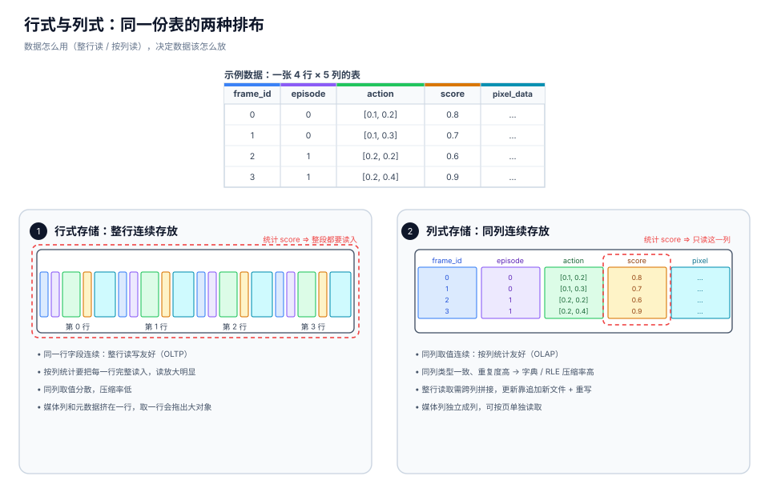
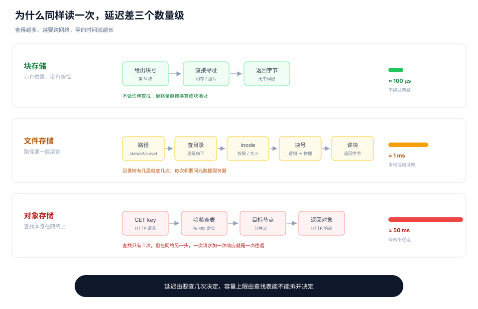

## 引子

上一篇 [视频数据存储：从编码原理到训练数据选型](/p/video-codecs/) 停在**编码层**，讲了视频编码怎么把一帧原始像素压缩成几十 KB 字节，以及由此产生的帧间依赖。

但是对于数据存储和吞吐还有一个重要的前置问题：编码得到的这些字节，怎么在物理存储上组织起来，以及这些组织方式对数据读取的效率有何影响？

本篇先讲这些字节是怎么被存下去的，以及不同数据格式、不同存储系统在写入时各有什么差别；再讲读取时怎么把它们取回来；最后介绍一种面向多模态数据的新格式 Lance。

## 存储的过程

根据前文（[一条视频的完整链路](/p/video-codecs/#一条视频的完整链路)），存储和读取夹在封装和解码之间。

```text
编码器 → 码流 → 容器封装 → [存储] → [读取] → 解码 → 帧
```

存储是把编码得到的字节按一定的组织方式放到物理存储上，读取则是按同一套组织方式把它们取回来。

先看存储的具体过程。字节写下去之前，要先定两块设计。

- **文件内部怎么排**：同一份数据里，各字段的字节按什么顺序放。这是**数据格式**决定的。
- **文件放在哪、怎么写**：整份文件存进哪类存储，写入后能不能改、能不能追加。这是**存储系统**回答的。

两个设计一旦定下，字节的排布和位置就固定了，读取也只能顺着这个来，否则读出来就是错乱的。

### 数据格式层：按行/按列存储

多模态数据集和普通表格有个结构差异，它是**少量元数据 + 超大媒体对象**。一条样本的记录可能只有几百字节（编号、时间戳、动作、分数），对应的视频或图像却有几十 MB。这些信息写进文件时怎么排，分两种，行式与列式。

先看一张带媒体列的数据表。

| frame_id | episode | action | score | pixel_data |
|---|---|---|---|---|
| 0 | 0 | [0.1, 0.2] | 0.8 | ... |
| 1 | 0 | [0.1, 0.3] | 0.7 | ... |
| 2 | 1 | [0.2, 0.2] | 0.6 | ... |
| 3 | 1 | [0.2, 0.4] | 0.9 | ... |

行式存储把**同一行的所有字段连续存放**，写入时来一行写一行（CSV、JSON 就是这样）；列式存储反过来，把**同一列的值连续存放**[^parquet]，写入时各列分别攒起来再写。

行式适合一次读写一整行的场景。电商下单要取出用户、商品、金额、地址，整行读一次就够，所以 MySQL、PostgreSQL 默认都是行式。但如果只想看某一列，会有**读放大**问题。CSV 这类变长格式没有记录每个字段的偏移，要定位某一列，必须先扫过同一行里它前面的字段；就算偏移已知，磁盘和数据库的读取单位也是块或页，同一行的其他字段会和目标字段一起被读入，取走需要的几个字节，其余丢掉。

列式存储则适合扫大量行、但只关心少数几列的场景。比如统计全表 score 的平均值，它只顺序读 score 那一列，其余列一个字节都不碰。并且由于同一列的数据类型一致，使用压缩技术后（字典编码、游程编码）的压缩率也明显高于行式。代价是读整行时要跨列把字段拼回来，改一行通常得追加新数据再重写。Parquet、ORC、ClickHouse 的 MergeTree 默认都是列式[^clickhouse]。

<figure>
  
  <figcaption>同一张表的两种排布。行式按行连续存放，列式按列连续存放。点击图片可放大查看。</figcaption>
</figure>

落到多模态数据集，选择取决于训练时怎么取数。需要完整取出一整行，行式一次连续读更高效；某些字段很大但训练时从不会完整取（比如 `pixel_data`），列式只读需要的列更划算。

### 存储系统层：文件物理布局

按访问接口分，存储系统有三类。块存储把容量切成固定大小的块，只提供按块号读写的裸接口，硬盘、SSD、云盘（如 AWS EBS[^ebs]）都属于它。文件存储在块存储之上加了一层文件系统，数据按目录树组织，通过 POSIX 接口[^posix]访问，ext4、NFS、HDFS 都算这一类。对象存储把目录树扔掉，只保留键到对象的扁平映射[^s3]，通过 HTTP 的 PUT/GET/Range GET/DELETE 操作，S3、OSS、MinIO 都是这一类。

三者根本的区别在于维护的元数据量。

<figure>
  
  <figcaption>读一次数据要走的链路。块存储不做查找，偏移量直接换算成块地址；文件存储要沿目录树逐级查，层数决定次数；对象存储只查一次，但这次查找要跨网络往返。点击图片可放大查看。</figcaption>
</figure>

块存储几乎不维护元数据，只记录第 N 块对应哪段字节。没有谁在用、谁打开了什么这类记录，所以没有额外开销，延迟最低，微秒级。也正因为没有这份记录，两台机器同时写同一块时没有任何冲突判断，只会互相覆盖。多台机器都能连上它，但同时读写会互相破坏，要安全共享只能在它之上再叠一层集群文件系统。同样，裸盘只属于一台机器，容量也就被单机挂盘限制住。

文件存储要维护的元数据最多，包括 inode、目录项、打开文件表和锁。每次访问都先查这个路径对应哪些块、你有没有权限、别人是否正在写，于是多机能看到同一份目录，也能只改文件中间的几个字节。

代价是这份记录必须集中，而且始终只有一份准确答案。同一个路径不管从哪台机器解析，都得出同一个结果，所以不能各机器各存一份目录。每次访问又要查它，放在磁盘上就多一次寻址，元数据服务器干脆把整棵树常驻内存。可每个文件、每个 block 都要在内存里占一条记录，文件越多、切得越碎，内存占用越大。所有机器还都来问同一份目录，加锁和同步也要花时间。两样一叠加，元数据服务器最先撑不住，HDFS 的 NameNode 就是这样成为瓶颈的，它的内存大小直接决定了集群能放多少文件。

对象存储干脆不要这棵树，元数据只剩键到对象的一层扁平映射。这层映射可以按哈希把键空间切成互不相干的分片，一个键落在哪个区间就归哪台机器管，每台机器只需知道自己负责的区间和邻居。扩容只是拆开某个区间、搬走一部分键，不必重建任何全局目录，所以容量近乎无限、成本最低。

代价是不能就地修改。一个对象的数据通常被切成多块、分散在不同机器上，改其中一个字节，就得让所有副本同时成功、失败时整体回滚。这是跨机器的分布式事务，而对象存储为了线性扩容，恰恰把这些协调机制拿掉了。于是原子单位被定成整个对象，修改就是写一个完整的新对象，全部写成功后再一次性替换键到新版本的映射，要么新版、要么旧版，没有中间态，也就是整体 PUT 重写。

访问方式也随之固定，只暴露 HTTP 接口。即使部署在本机（比如 MinIO），请求也要穿过网络栈和存储进程，不像块存储那样直接调驱动读盘。这时读取延迟取决于它离你多远，本机百微秒、同机房毫秒、云上跨网络几十毫秒。

> **当数据达到 PB 级时，块存储装不下，文件存储的元数据树太大，只剩对象存储能承载。** 而个人电脑上的数据规模小、又需要频繁编辑，所以一般放在文件存储上。

## 读取的过程：两级索引

存好之后，剩下的问题是怎么取回来。读取的过程可以概括为一句话。**先拿到索引，再按索引做一次物理读**。索引分两级。

第一级是**逻辑索引**，由数据格式给出。它指出这次要取的数据落在哪一行、要读哪几个字段、这些字段又落在哪几页。行对应一条记录，也就是一条样本。列对应一个字段，比如时间戳、动作、分数、图像字节。页则是列内部切出来的连续字节块。三者合起来就是逻辑索引，只描述结构，不涉及字节在磁盘上的位置。

第二级是**物理索引**，由存储系统给出。它把页号翻译成对象键加字节区间，也就是从哪个对象的哪个字节开始、读多长。拿到它，才能发出真正的读取请求。

有了物理索引，最后只剩**物理读**，按区间把字节取回来，交给解码器解成像素或张量。

举个具体的例子。训练时随机采样到第 1240 帧，数据格式先给出逻辑索引，元数据在第 1240 行，视频数据落在对应的那几个页；由于这一帧不能单独解码，页的范围要从最近的关键帧（第 1200 帧）算起，覆盖 41 帧。存储系统再把这些页换算成物理索引，某个对象上 3.20 MB 到 3.38 MB、共 180 KB，按它发一次范围请求，只取这 180 KB，而不是整个视频文件。解码器最后从第 1200 帧开始解，解出 41 帧，只留下第 1240 帧。

## Parquet、pickle 与 Lance

前面把格式分成行式和列式，实际使用中有这几种。Parquet 和 ORC 是列式，也是数据湖里用得最多的两种。Lance 同样是列式，但它是专门为随机访问重新设计的。pickle 严格说不算列式格式，它只是把 Python 对象整体序列化后写到磁盘，之所以放在一起说，是因为很多人第一反应就是拿它存数据。

三者最关键的差别，在于随机取一条记录要读多少字节。

| 格式 | 组织方式 | 取一条记录的代价 |
|---|---|---|
| pickle | 整个对象一次序列化 | 必须读完整个文件 |
| Parquet | row group → 列 → page | 定位到 row group，再读一整页 |
| Lance | 列 → page | 直接跳到对应 page，几十 KB |

pickle 的代价最大。它把整个对象一次性序列化，读的时候也要整体反序列化，取一条和取全部是一个开销。小规模调试或进程间传对象没问题，当作数据集格式用就不合适了。真要按需读，只能按样本拆成多个 pickle 文件，每个只存一条，代价是文件数量随之膨胀。

Parquet 按 **row group** 组织，先把一批行攒成一个块（默认通常是上百 MB 量级），块内再按列存。这个结构是为扫描大量行优化的。随机取一行时，它只能先定位到这一行所属的 row group，再读这个 row group 里对应列的一整页，而页本身通常有 1 MB 量级，哪怕只要其中一个值。

媒体数据则通常不放进表里，例如具身领域流行的 [LeRobot](https://huggingface.co/lerobot) 格式，表中只存 `episode_000123.mp4` 这样的路径字符串，视频文件另存，读表时不必加载媒体本身。

Lance[^lance-format] 是 Rust 实现的列式格式，可以直接跑在 S3、OSS 上，它针对读取粒度和媒体存放各改了一处。

**取消 row group，只保留列内 page。**

每列切成若干 page，page 之间互相独立，页元数据里直接记行号范围。这样随机取一条记录时，只需读它所在的那几个 page、只拉所需字节，不必被 row group 这层粗粒度结构拖累。配合对象存储的 Range GET[^s3-range]，一次请求就能精准取到几 KB。

举个具体的例子。一张 100 万行的表，三列 `id`、`score`、`video`，`score` 每行 8 字节，现在取第 734561 行的 `score`。

* Parquet 的读法分五步。先读文件末尾的元数据，知道表被切成 8 个 row group、每个约 12.5 万行；再累加前 5 个 row group 的行数，确认这一行落在第 6 个；然后找到 `score` 列在这个 row group 里的 page，12.5 万行乘 8 字节刚好 1 MB，整列只有一页；接着把这一页读下来，压缩后约 0.3 MB；最后整页解压，从 12.5 万个值里取出第 109561 个。

* Lance 的读法少两步。页索引里直接记着每页覆盖的行号范围，第 734561 行命中「728000 到 736000」这一页，位置是页内第 6561 个值；按索引里的偏移和长度发一次范围请求，读 64 KB；页内直接跳到目标位置，不需要从头解压。

单看一条，读量是 300 KB 对 64 KB，约 5 倍。但训练一个 batch 要随机抽 1000 条，而且散落在整张表里，合计就成了 300 MB 对 64 MB。

**把大对象列和元数据放进同一份格式。**

视频、图像直接作为 blob 列存在同一个数据集里，不再有表和外部文件两套系统。读一条样本时，元数据和对应的媒体字节都在同一份 manifest 的索引下，一次定位就够。

Lance 的好处有三条。随机取一条记录时只读几十 KB，Parquet 要读一整页；图像、视频和元数据存在一起，不用维护两套系统；每次写入都会留下一个版本，想回看历史随时可以。

代价也有四处。能用的工具少，虽然 Spark、DuckDB 都有对应接口[^pylance]，但分析平台和报表工具的支持远不如 Parquet；小批量频繁写入会攒出很多小文件，得定期合并；每写一次就多一个版本，旧版本不清理会一直占空间；改一行也要先标记删除再写新数据，频繁修改并不划算。

[^ebs]: AWS, 2026, "What is Amazon EBS?". Amazon EBS User Guide. https://docs.aws.amazon.com/ebs/latest/userguide/what-is-ebs.html

[^posix]: Wikipedia, "POSIX". https://en.wikipedia.org/wiki/POSIX

[^s3]: AWS, 2026, "What is Amazon S3?". Amazon S3 User Guide. https://docs.aws.amazon.com/AmazonS3/latest/userguide/Welcome.html

[^s3-range]: AWS, "GetObject — Range". Amazon S3 API Reference. https://docs.aws.amazon.com/AmazonS3/latest/API/API_GetObject.html

[^parquet]: Apache Parquet, "Parquet Documentation". https://parquet.apache.org/docs/

[^clickhouse]: ClickHouse, "Distinctive Features of ClickHouse". https://clickhouse.com/docs/about/distinctive-features

[^lance-format]: Lance Format, 2026, "Lance File Format". https://lance.org/format/file/

[^pylance]: Lance, 2026, "Getting Started with PyLance". https://lance.org/quickstart/pylance/
