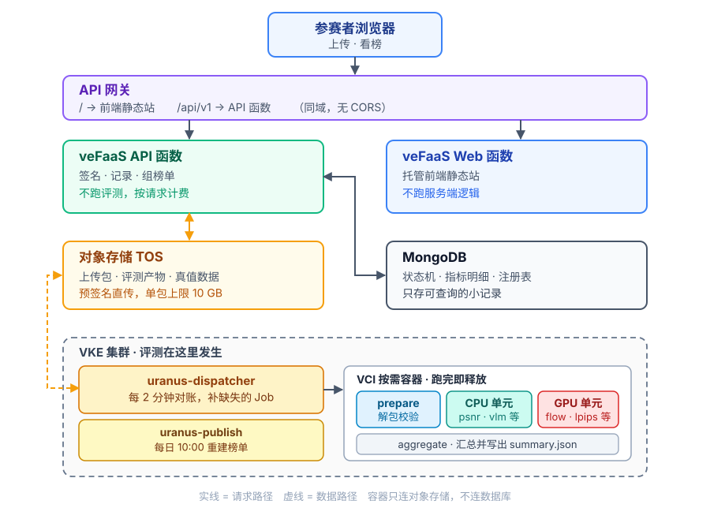

## 引子

在早期的迭代中，Uranus 模型[^uranus] 训完一版，选择几条测试样本生成得到可视化视频；人工逐条看完，这版感觉「好像稳了一点」。再换一版，又感觉「好像差了一点」。两条视频之间到底差多少、差在哪个维度，说不清；换个人来看，结论可能还不一致。

没有评测就没有迭代，这条规则适用于所有工程。没有稳定的量化口径，每次优化都只是换个方向重新试错，无法积累下确定有效的结论。但评测本身也是负担：专人维护低效，自己搭机器又会长期占着 CPU 和 GPU。所以问题变成——**如何搭一套既不需要专人维护、也不必常驻占用算力的评测平台**？

本文围绕这个问题展开：先说怎么评测一个仿真器的优劣，再说平台怎么搭。整个项目的执行和代码编写都通过 vibe coding 完成，最后会总结用 Agent 管住一个 AI 原生项目的经验。

## 评测一个仿真器

Uranus 属于数据驱动的仿真器。它不写物理方程，而是用生成模型按机器人动作序列预测后续画面，输出是一段预测的视频。但靠肉眼判断输出视频的好坏，既低效也不可靠，给不出稳定的量化结论。

社区已有一些非人工的量化评测方案。WorldArena 把具身世界模型的评测拆成感知质量和功能可用性两层，感知层用 16 个指标覆盖 6 个子维度，最后聚合成一个 EWMScore[^worldarena]。WorldOracle 以真实执行为标尺，把模型对同一段动作的预测与真机录像配对比较，从物理状态是否正确、交互位置是否对齐、关键交互区域是否保真、多视角是否一致四个维度打分[^worldoracle]。

公开榜单解决不了我们的问题，原因有三点：

- 评测集：需要自定义，来源要多样，覆盖不同场景、不同任务和不同机器人型号，才能测出模型的泛化能力。
- 评测指标：现有工作的指标并不完全可靠，比如基于大模型打分的那一类指标。
- 全自动化：评测由平台驱动，人只负责提交模型或结果，过程可追踪，能力可扩展。

所以需要自己设计一套评测系统，这样评测集和指标都可以自定义，平台依托云服务托管，随时可以调整。

最初的评测集由 agent 构造：保证每个任务、每个场景相互独立，覆盖不同的机器人型号，同时尽量排除干扰，比如场景里的其他机器人、其他物体和走动的人。指标上参考了以往工作，以有参考性指标为主（和 GT 对比算出的 PSNR、LPIPS、CD-FVD），无参考性指标（IQA、大模型打分等）只给较低权重。

## 自动化评测平台：全按需的架构

平台设计上需要满足三条硬要求：

1. 按需激活，评测容器只在有提交时启动，跑完立即销毁；
2. 评测容器的创建和回收全自动，不需要人工干预；
3. 新增指标或评测集只需改配置，不改已有代码。

第一条直接决定成本和维护量。它的反面是常驻方案：买几台 GPU 机器长期跑评测，可提交集中在少数几个下午，其余时间机器空转；服务一旦常驻，部署、扩容、故障处理也都得有人盯着。按需的核心是 **Serverless（无服务器计算）**，只在请求发生时分配资源，没有提交时没有任何评测容器在运行。

平台一共有六类组件，下图是它们的职责边界：

<figure>
  
  <figcaption>上半是请求路径，中间是数据层，下半是计算层；评测容器只读写对象存储，从不连数据库。</figcaption>
</figure>

想逐个点开看职责，可以打开 <a href="/uranus-benchmark-eval-platform/architecture.html">可交互架构图</a>。

这张图分三层读。**上半部分是请求路径**：浏览器把请求交给网关，网关按路径分流——`/` 落到托管前端的 Web 函数，`/api/v1` 落到处理业务的 API 函数。**中间是数据层**：参赛包、评测产物、真值数据这类大文件进对象存储，提交状态、指标明细、榜单这类需要查询的小记录进 MongoDB。**下半部分是计算层**：集群里只有两个常驻组件，`dispatcher` 负责查看任务队列、按需拉起一次性容器，`publish` 定时重建榜单；准备、评测、汇总这些容器都是跑完即销毁的，不会常驻资源。

值得注意的是，API 函数不触发评测，评测容器也不回调函数，两边只通过对象存储里的产物和数据库里的状态间接协作。数据层按访问方式分。提交记录、提交 ID、状态、榜单这些数据只有几百字节，却要频繁查询、排序、去重和过期，所以放 MongoDB；提交的视频、真值视频、评测产物这些大文件放对象存储。图中还有一个 `publish` 模块是单独拆出来的，主要为承办比赛准备；其实目前它就是一个定时任务，每天早上 10 点跑一次，重算榜单并把新结果更新到前端。

下表是组件的职责和设计目的。

| 组件 | 职责 | 设计目的 |
|---|---|---|
| API 网关（APIG） | 同域分发：`/` 给静态站，`/api/v1` 给函数 | 前后端同域，没有 CORS，前端全部用相对路径 |
| API 函数（veFaaS） | 签发上传地址、读写记录、组榜单 | 常驻业务逻辑只有这一份，按请求计费 |
| Web 函数（veFaaS） | 托管前端构建产物 | 静态站，不跑服务端逻辑 |
| 对象存储（TOS） | 上传包、评测产物、真值数据、参赛包 | 大对象整读整写，浏览器靠预签名直传直下 |
| 文档数据库（MongoDB） | 提交状态机、指标明细、指标注册表 | 需要查询、排序、去重、TTL，这些是对象存储做不到的 |
| 容器集群（VKE + VCI） | 跑校验与评测，跑完即释放 | 按实例存活秒计费，没有提交就不存在 |

在这个架构下，扩展新指标也比较方便：一个指标（或一组共享模型的指标）就是一个 VCI 容器入口，增减只改注册表，不动 API 函数，也不动其他单元。

## Agent 管理：维护日志

项目最初的方案是和 leader 讨论定下来的。我几乎没有开发经验，最开始连 VCI、FaaS 是什么都不知道，能推进下去全靠 Agent。但把一整个项目交给 agent，不是几段对话就能完成的，需要一套调度管理。

其实主要经验只有一条：让 Agent 维护改动日志。平台现在有什么问题、开发到哪一步，都从日志里读；多个 Agent 同时干活时，也靠日志互相协调、避免冲突。本质上就是给 LLM 补一份持久化的 Memory。

[^worldarena]: Shang, Y. et al. WorldArena: A Unified Benchmark for Evaluating Perception and Functional Utility of Embodied World Models. arXiv:2602.08971. https://arxiv.org/abs/2602.08971
[^worldoracle]: Duan, H. et al. WorldOracle: Benchmarking Action-Conditioned World Models against Real-World Executions. arXiv:2610.18826. https://arxiv.org/abs/2610.18826
[^uranus]: D-Robotics AI Lab. Uranus 技术报告. https://arxiv.org/abs/2609.24815
[^vefaas]: 火山引擎. 函数服务 veFaaS 产品文档. https://www.volcengine.com/product/vefaas
[^vci]: 火山引擎. 容器实例 VCI 产品文档. https://www.volcengine.com/product/vci
[^tos]: 火山引擎. 对象存储 TOS 产品文档. https://www.volcengine.com/product/tos
[^bson]: MongoDB. BSON Document Size Limit. https://www.mongodb.com/docs/manual/reference/limits/#mongodb-limit-bson-document-size
[^cronjob]: Kubernetes. CronJob 文档. https://kubernetes.io/zh-cn/docs/concepts/workloads/controllers/cron-jobs/
