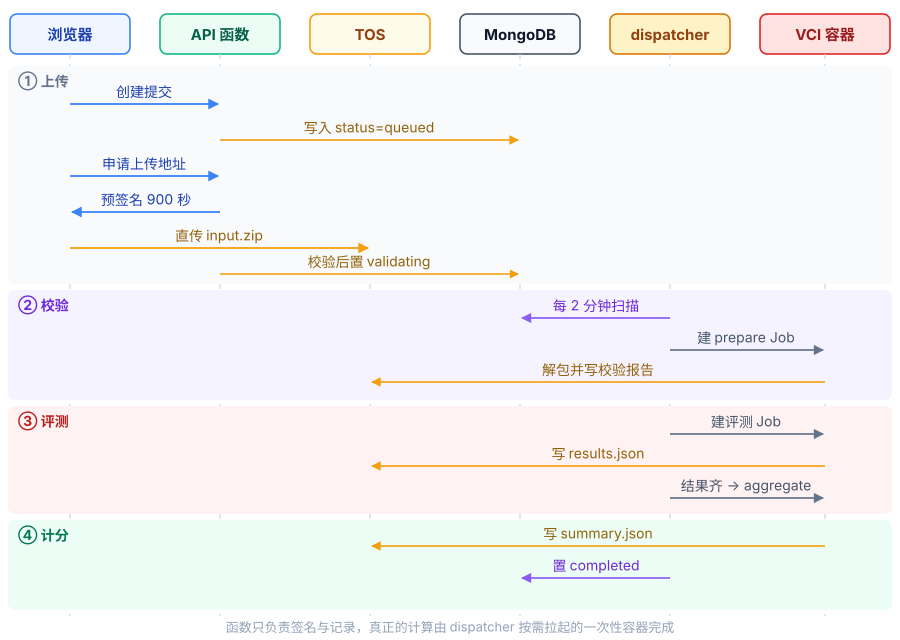

## 引子

在早期的迭代中，Uranus 模型[^uranus] 训完一版，选择几条测试样本生成得到可视化视频；人工逐条看完，这版感觉「好像稳了一点」。再换一版，又感觉「好像差了一点」。两条视频之间到底差多少、差在哪个维度，说不清；换个人来看，结论可能还不一致。

没有评测就没有迭代，这个规则适用在所有工程迭代项目中。没有稳定的量化口径，每次优化都只是换个方向重新试错，无法积累下确定且有效的结论。搭建一套自动化评测管线刻不容缓；此时问题来了，如果专门让一个人来维护评测这件事，低效且无聊；在一台机器上搭建评测服务，也会遇到资源占用和成本问题。那么如何 **搭建一套既不需要人维护也不能常驻占着 CPU/GPU 的评测平台**？

本文的内容大致围绕这个问题展开，先介绍如何评测一个仿真环境的优劣，在说如何搭建自动化的评测平台。整个过程所有的执行和代码编写都是通过 Vibe coding实现，在最后我也会总结完成一个 AI native 项目的一些技巧。

## 评测一个仿真器

Uranus 属于数据驱动的仿真器。它不写物理方程，而是用生成模型按机器人动作序列预测后续画面，输出是一段预测的视频。通过肉眼观察模型输出的视频，人工判断它的质量是低效且不可靠的，无法作为一个稳定的量化指标。

目前社区提供了一些评测方案来实现非人工的量化评测。WorldArena 把具身世界模型的评测拆成感知质量和功能可用性两层，感知层用 16 个指标覆盖 6 个子维度，最后聚合成一个 EWMScore[^worldarena]。WorldOracle 以真实执行为标尺，把模型对同一段动作的预测与真机录像配对比较，从物理状态是否正确、交互位置是否对齐、关键交互区域是否保真、多视角是否一致四个维度打分[^worldoracle]。

公开榜单解决不了我们的问题。主要的原因有三点：

- 评测集：我们希望自定义评测集，评测集的来源可以多样且丰富，为了更好的评测模型的泛化能力，评测集应该包含不同的场景、不同的任务、不同的机器人模型。
- 评测指标：目前工作的评测指标在我们看来并不可靠，比如说基于大模型打分的指标等。
- 全自动化：评测平台应该是全自动化的，即评测过程完全由平台驱动，人工只需提交结果或者新训练的模型，并且结果可追踪，功能可扩展。

因此，我们必须自己设计一套评测系统，能够自定义评测集，评测指标；并且整个平台由我们来托管维护，我们可以随时做出调整和迭代方案。

在最初的版本中，我们的评测集的获取方式，是通过agent处理出任务独立，场景独立，有各种不同的机器人模型；也尽量避免干扰因素，比如说环境中的其他机器人、其他物体，运动的人等。评测指标的选择，参考了以往的工作，更侧重于使用参考性的指标（于GT对比计算得到的指标，PSNR，LPIPS，CD-FVD），而给无参考性的指标较低的权重（如IQA，大模型指标等）。

## 自动化评测平台

这一节讲平台本身。对平台开发不感兴趣的读者可以直接跳到文末，前面的评测结论不依赖这些实现细节。

### 全按需的架构

平台设计上需要满足三条硬要求：

1. 按需激活，评测容器只在有提交时启动，跑完立即销毁；
2. 评测容器的创建和回收全自动，不需要人工干预；
3. 新增指标或评测集只需改配置，不改已有代码。

第一条就是为了让整个评测系统易于维护、节省成本。其反面是常驻方案，也就是买几台 GPU 机器长期跑评测服务。这个方案的成本结构和实际负载完全对不上，提交测试集中在少数几个下午，其余时间机器空转；而服务一旦常驻，部署、扩容、故障处理都需要人力来维护。按需的核心就是 **Serverless（无服务器计算）**，类比打车而不是买车。不为「可能到来的请求」预留资源，只为「已经发生的请求」付费。落到这套系统上只有一句话——**没有提交时，没有任何评测容器在运行**。

下面介绍平台的设计框架，架构里一共有六类组件，下图展示了它们的职责边界：

<figure>
  
  <figcaption>上半是请求路径，中间是数据层，下半是计算层；评测容器只读写对象存储，从不连数据库。</figcaption>
</figure>

<p style="text-align:center;margin:-0.4rem 0 1.6rem;font-size:0.9rem;color:#64748b;">想逐个点开看职责，可以打开 <a href="/uranus-benchmark-eval-platform/architecture.html">可交互架构图</a>。</p>

这张图分三层读。**上半部分是请求路径**：浏览器把请求交给网关，网关按路径分流——`/` 落到托管前端的 Web 函数，`/api/v1` 落到处理业务的 API 函数。**中间是数据层**：参赛包、评测产物、真值数据这类大文件进对象存储，提交状态、指标明细、榜单这类需要查询的小记录进 MongoDB。**下半部分是计算层**：集群里只有两个常驻组件，`dispatcher` 每 2 分钟对账、按需拉起一次性容器，`publish` 定时重建榜单；准备、评测、汇总这些容器都是跑完即销毁的。

值得注意的是，API 函数不触发评测，评测容器也不回调函数，两边只通过对象存储里的产物和数据库里的状态间接协作。这样拆的好处是加指标不改架构——一个指标（或一组共享模型的指标）就是一个容器入口，增减指标只改注册表，不动 API 函数，也不动其他单元。

存储分成两种，是因为两类数据的访问方式正好相反。提交记录、指标明细、榜单都是几百字节的小记录，却要按状态筛选、按分数排序、按用户去重、按时间过期，这些只有数据库能做，对象存储既不能查也不能排；参赛包、视频、真值和评测产物是另一头，单个动辄几 GB，一辈子只被整体读写一两次，靠预签名地址直传直下，不占函数的内存和带宽。反过来放都会出事：视频进数据库，记录大小、内存和备份成本一起失控；小记录进对象存储，每次查询都得把整份数据拉回来自己算。判据因此只有一条——需要查询、排序、去重、过期的进 MongoDB，按对象整体读写的大文件进 TOS，只活一次的中间态留在容器临时盘。这样数据库里永远只有小记录，查询快、备份便宜，对象存储专心装大文件，容量和流量按量计费。

单独拆出 `publish`，是为承办比赛留的发榜能力。榜单由它定时全量重算——遍历所有提交，按当前权重重算总分，再生成一份快照；放进请求函数会超出执行时限，也抬高按请求计费的成本。比赛时只需调整触发时机：赛前预热、赛期刷新、赛后定格，复赛或分榜换一套过滤条件重跑即可。

下表是组件的职责和设计目的。

| 组件 | 职责 | 设计目的 |
|---|---|---|
| API 网关（APIG） | 同域分发：`/` 给静态站，`/api/v1` 给函数 | 前后端同域，没有 CORS，前端全部用相对路径 |
| API 函数（veFaaS） | 签发上传地址、读写记录、组榜单 | 常驻业务逻辑只有这一份，按请求计费 |
| Web 函数（veFaaS） | 托管前端构建产物 | 静态站，不跑服务端逻辑 |
| 对象存储（TOS） | 上传包、评测产物、真值数据、参赛包 | 大对象整读整写，浏览器靠预签名直传直下 |
| 文档数据库（MongoDB） | 提交状态机、指标明细、指标注册表 | 需要查询、排序、去重、TTL，这些是对象存储做不到的 |
| 容器集群（VKE + VCI） | 跑校验与评测，跑完即释放 | 按实例存活秒计费，没有提交就不存在 |

这套结构的好处是加指标不改架构。一个指标（或一组共享模型的指标）就是一个容器入口，增减指标只改注册表，不动 API 函数，也不动其他单元。

代价也很直接：链路上多了一次「状态对账」，任何一步失败都不会有人直接重试，而是等下一轮扫描。后面会看到，这个代价换来了容错，也埋过坑。

### 一次提交的旅程

一次提交从点击上传到榜单可见要经过四个阶段。阶段之间不保持长连接，全靠数据库里的状态推进。

<figure>
  
  <figcaption>从上往下读：浏览器只和函数、对象存储打交道，评测发生在最后三个参与者之间。</figcaption>
</figure>

**上传阶段**要对付一个硬限制：网关的同步请求体上限只有 16 MiB[^vefaas]，参赛包却最大允许 10 GB。做法是三段式——先创建提交记录，再向函数申请一个 900 秒有效期的预签名地址[^tos]，最后由浏览器把文件直接传到对象存储。文件流不经过函数，网关限制就不再生效。

**校验阶段**先跑一个 `prepare` 单元：解包、做白名单检查、把视频归一化到固定目录、写出校验报告。这一步失败会标记为 `validation` 类型并且不重试——同一个包再跑一次结果必然相同，该做的是让参赛者修包重传；运行时崩溃属于另一类失败，允许重试。

**评测阶段**是真正花钱的部分。调度器照着指标注册表，为每个还没有结果的单元建一个 Job：GPU 单元跑光流、画质、感知相似度和分布距离，CPU 单元跑像素指标和几类需要调远程模型服务的指标。单元之间互不依赖，谁先完成都行。

**计分阶段**等所有单元出结果，再起一个汇总单元，把各指标合成总分写回数据库，最后触发榜单快照重建。

贯穿全局的设计是**产物即真相**：判断某个单元是否完成，不看 Job 的状态，而看对象存储里那个结果文件是否存在。Job 名是确定性的，同一个提交的同一个单元永远叫同一个名字，所以重复派单是幂等的。

这套机制让系统可以随时重启，调度器不在内存里存状态，每 2 分钟从数据库重新读一遍[^cronjob]，缺什么补什么。代价是残留对象会被误判为「已完成」，后面关于重传的坑就是这么来的。

状态词只有一套：`queued → validating → evaluating → scoring → completed / failed`。没有额外的进度字段，页面上的徽章、详情页的步骤条、后台计数读的都是同一个字段。少一套词，就少一类前后端对不上的 bug。

### 调度与配额的取舍

评测里最贵的资源是 GPU，而配额不能随意切分，它挂在四个维度上：**账号 × 地域 × 可用区 × 规格族**[^vci]。只换规格不换区，配额用满时依然会报 `ExceededQuota`。

更麻烦的是虚拟节点上报的容量远大于真实值（例如 `nvidia.com/gpu: 1k`），调度器打分时所有节点永远打平，结果是所有 Pod 默认落到同一个可用区。一个区的配额耗尽后，多出来的 Pod 不会被自动挪走，只会创建失败，然后一直等，直到超时被判死。

解决办法是放弃「让调度器自己选」，改成显式钉住：每个 Pod 打上可用区标签并加节点选择器，一条提交的四个 GPU 单元锁在同一个区；调度器按区统计已用卡数，余额不够就把下一份提交溢到另一个区，都满了就跳过这一轮——是跳过，不是判失败。

另一个被线上推翻的设计是失败策略。最初用 `fail-fast`：实例创建失败就终止。听起来合理，但一次性申请 4 张 GPU 时创建失败很常见，`fail-fast` 会让 Pod 永久挂起，熬满一小时的截止时间后整条提交失败。改成 `fail-back` 退避重试后，同一个提交能自己等到有库存的时刻。

规模上的账可以这样算：

```text
基准：一次提交固定要 4 个 GPU 单元，每个占 1 卡
卡池：80 卡 ÷ 4 卡/份 ≈ 20 份同时评测

常驻方案（维持 20 份并发能力）：
  20 份 × 4 卡 × 24 h ≈ 1920 卡时/天

按需方案（每天 20 份提交，每份平均 40 分钟）：
  20 份 × 4 卡 × 0.67 h ≈ 53 卡时/天

相差约 36 倍
```

这个倍数只适合判断量级，实际值取决于提交密度；提交越稀疏，按需的优势越大。反过来，如果每天都有稳定的大量提交，按需的单价优势会被启动开销吃掉——虚拟容器按实例存活秒计费，拉镜像的时间也计费，而 GPU 镜像接近 20 GB。

启动开销还带来一个隐性约束：单元的超时时间不能按「计算耗时」设。最初按 30 分钟设，结果某个调用远程模型的单元稳定超时；抬到 3 小时后才稳定。这类数字只能从线上日志里读出来，估算没有意义。

并发也设了上限：每个用户最多 5 份未完成提交。没有这个闸门，一个人批量上传几十份就能把卡池占满，其他人的提交永远排在后面。

## AI 原生开发习惯

架构、指标口径、调度策略是人定的，代码、部署脚本、文档大部分是 AI 写的。这个分工能跑起来，靠的不是模型能力，而是把协作规则写进仓库——下面几条都是实际在用的，不是原则。

**维护日志按四段写，当天写完。** 每次改动往运维手册追加一条：改了什么（文件、字段、镜像 tag）、为什么（报错原文或线上现象，以及否决了哪个方案）、怎么验证（命令和输出）、还剩什么没做。最容易省略也最值钱的是失败尝试。比如调度策略从 `fail-fast` 改成 `fail-back`，如果只留代码，下一个人看到的只是一个参数名，看不到「`fail-fast` 会让 Pod 挂满一小时、最后整条提交失败」这个结论，很可能又改回去。反过来，拖到周末补记，日志里只会剩「调整了若干文件」。

**多 agent 并行按文件边界切，不按功能切。** 并行的前提是每个 agent 写的文件不重叠。这次写这篇文章就是两个 agent 同时开工：一个读 79 KB 的部署设计文档，一个读两千多行变更历史，各自只返回结构化笔记、不写文件，主流程拿到两份笔记再落笔。上下文没被长文档撑爆，也没有合并冲突。

实现类任务同理，但要先固定契约：接口签名、数据结构、状态词先写死，再让 agent 各写各的模块。共享文件必须串行——指标注册表、路由注册表、文案文件这类东西，两个 agent 同时改必然互相覆盖。判断标准很简单：两个任务要改的文件如果有交集，就不能并行，哪怕功能上确实无关。

**只留一个可以改的地方。** 指标清单只在一个 JSON 里，存储路径只在一个模块里拼，数据库集合和索引只在一处定义。AI 最常犯的错不是写错逻辑，而是在需要的地方顺手再复制一份常量，两份过两周就不一致了。所以用结构堵死：生成目录由脚本产出，手改会在下次同步时被覆盖；配置只有一处可改，其他位置只能引用。

**故障当场压缩成一句话。** 每次线上问题按现象、根因、修复、验证记一遍，然后压成陷阱清单里的一行，例如「GPU 配额挂在账号 × 地域 × 可用区 × 规格族上，只换规格不换区解决不了 `ExceededQuota`」。同一类问题出现第二次，就升级成 checklist 或技能文件。这套做法已经整理成三个可复用的文件：维护日志怎么写、给 AI 的入口文件怎么组织、故障怎么复盘。

**也有代价。** AI 写代码快，但会自信地沿用错误前提。有过一次把「已完成的 Job」当成「已完成的产物」，直接导致重传功能失效——Job 确实还在，但它永远不会再写结果。这类错误的共同点是没有可观察的验证，只有读代码得出的结论。所以验收标准必须落在事实上：跑一次、看输出、比对哈希。

[^worldarena]: Shang, Y. et al. WorldArena: A Unified Benchmark for Evaluating Perception and Functional Utility of Embodied World Models. arXiv:2602.08971. https://arxiv.org/abs/2602.08971
[^worldoracle]: Duan, H. et al. WorldOracle: Benchmarking Action-Conditioned World Models against Real-World Executions. arXiv:2610.18826. https://arxiv.org/abs/2610.18826
[^uranus]: D-Robotics AI Lab. Uranus 技术报告. https://arxiv.org/abs/2609.24815
[^vefaas]: 火山引擎. 函数服务 veFaaS 产品文档. https://www.volcengine.com/product/vefaas
[^vci]: 火山引擎. 容器实例 VCI 产品文档. https://www.volcengine.com/product/vci
[^tos]: 火山引擎. 对象存储 TOS 产品文档. https://www.volcengine.com/product/tos
[^cronjob]: Kubernetes. CronJob 文档. https://kubernetes.io/zh-cn/docs/concepts/workloads/controllers/cron-jobs/
