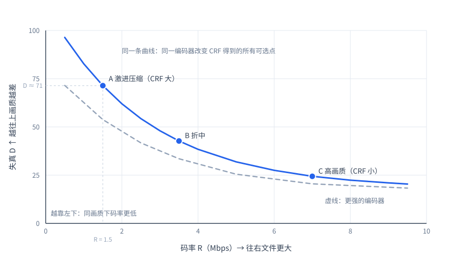
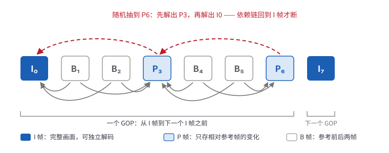

## 引子

最近在搭数据基建，视频数据部分最占存储，读取链路又最长——取字节、解封装、解码、缩放再搬进显存，每一步都可能卡住，所以最考验吞吐。规模到 TB、PB 之后，编码和容器的选择主要影响两件事：占多少存储、读得多快。这两者之间是典型的 trade-off——压得越狠，存得越省，但解码越重、读得越慢，数据供给跟不上，GPU 就只能空转。

这篇文章从像素讲起，先讲压缩和编码标准，再回到大模型生产本身，讨论数据编码选型和吞吐速度优化。

## 视频压缩

理解视频的存储需要从图片说起。众所周知，图片在计算机中实际上是由**像素**排列组成的平面，每一个像素记录一个颜色值。其中最常见的记录方式是 **RGB**：把颜色拆成红、绿、蓝三个通道，每个通道用一个 0–255 的整数表示亮度。

```text
一个像素 = (R, G, B) = (255, 128, 0)   # 橙色
每个通道 1 字节，所以一个像素 3 字节
```

一张 **1920×1080** 的图片，有 1920×1080 ≈ 207 万个像素，占：

```text
1920 × 1080 × 3 字节 ≈ 6.2 MB
```

这就是一张未压缩的 1080p 图片。图片在视频中称为**帧（frame）**，视频的本质是**帧的序列**；这些帧按顺序播放，就构成了视频。

一个视频的播放速度，一般用 **帧率（fps, frame per second）** 来表示。意思是每秒播放多少帧，常见的是 24、25、30、60。帧率越高，画面越连贯，但每秒要存的数据也越多。

那想象一个 1080p、30fps、时长 1 分钟且**未经过任何压缩**的视频，它的体积是：

```text
1920 × 1080 × 3 字节 × 30 fps × 60 s ≈ 11.2 GB
```

一个 1 分钟的 1080p 视频就要占 11 GB 左右；一部两小时的电影按同样方式存，需要的存储量级在 TB 以上。这显然不现实；现实中下载一部电影通常也就 GB 级别，因为几乎所有视频在存储前都会被压缩。

### 压缩原理

视频之所以能压缩，是因为数据里存在大量冗余。按来源可以分成四类。

| 冗余类型 | 通俗理解 | 来源 | 例子 |
|---|---|---|---|
| 空间冗余 | 一张图里相邻的地方长得像 | 自然图像由连续色块构成，相邻像素的取值接近 | 天空、白墙、桌面：几百个像素颜色几乎一样，只需记录“这一块是同一个颜色” |
| 时间冗余 | 前后两帧几乎没变 | 相邻两帧间隔只有 1/24–1/60 秒，画面变化很小 | 固定机位拍人走动：背景不动，只记录人的位置变化和移动方向 |
| 视觉冗余 | 人眼看不出的细节，可以丢掉 | 人眼对亮度敏感，对色度和细微纹理不敏感 | 每 2×2 个像素共用一份颜色（4:2:0），颜色边缘会略糊，但肉眼看不出差别 |
| 统计冗余 | 重复出现的值太多，可以用更短的编码表示 | 压缩后大量数值为 0，或集中在少数几个值上 | 一个 8×8 块共 64 个数，其中大部分是 0，只需记录少数非零值的位置和大小 |

如果学习过信息论，这里就很好理解。熵可以理解为“一段数据有多难猜”。越好猜（大片同色、相邻帧几乎不变），熵越低，需要记录的信息就越少；越难猜，熵越高，越难压。在视频中，非冗余的部分才是“信息”，压缩的目标就是把这部分组织得更紧凑。

压缩方法按是否允许丢失信息，分为**无损压缩**和**有损压缩**两类。

**无损压缩：** 通常做法是把出现得多的值用短代码表示，出现得少的用长代码，就像摩斯电码里最常见的 E 只用一个点；解码时按同一张码表倒着翻译，就能把原始数据一位不差地还原。ZIP、PNG、FFV1 都是这个思路。根据信息论，无损编码的平均码长不可能低于熵本身。在视频压缩中，无损压缩能可逆地利用空间和时间相关性，并消除统计冗余。

**有损压缩：** 有些信息丢掉之后，在使用场景下是可以接受的。例如视频中的视觉冗余，人眼对它不敏感，丢掉之后画面在观感上几乎不变，但数据量可以降一个数量级。



<a id="rate-distortion-curve"></a>
<figure>
  
  <figcaption>率失真曲线：每个点是一种编码配置实测得到的“码率—失真”组合</figcaption>
</figure>

丢掉视觉冗余本质上是一个 **Trade-off**：丢得越多，**码率**（每秒要存多少数据，单位 Mbps）越低、文件越小，但画质也越差。工程上，**率失真** 描述的就是这条取舍曲线：允许的失真越小，需要的码率就越高；允许的失真越大，码率就可以越低。

具体怎么“丢”，靠编码器里的一个参数 **CRF (Constant Rate Factor)** 来控制，可以把它理解成“画质目标”的旋钮。编码器压缩时，会对每个块决定丢弃多少细节：丢得多，文件小、画质差；丢得少则相反。CRF 让你只定目标画质，剩下的交给编码器自己分配——画面复杂的地方多留些细节，平坦的地方多压一点。所以 CRF 越**小**，画质越高、文件越大。




### 压缩的过程

**视频编码**就是把一帧帧像素压缩成体积更小的数据的过程，其中负责压缩的程序叫**编码器**，负责还原的叫**解码器**，两者合称 **codec**。不管哪种编码方法，核心都是同一条流水线：

```text
原始块 → 预测 → 残差 → 变换 → 量化 → 熵编码 → 码流
```

- **预测**：用相邻像素或参考帧预测当前块，只编码差值（残差）；帧内部的预测叫帧内预测，跨帧的叫帧间预测。
- **变换 + 量化**：把残差转到频域，再除以步长取整。量化是唯一有损的环节，步长决定丢多少细节。
- **熵编码**：对量化结果做无损压缩，消除统计冗余。

<a id="gop"></a>
<span style="color:#FF6B35"> 因为帧间预测要参考别的帧，帧就有了类型之分：**I 帧**存完整画面、不需要参考任何帧，可以独立解码，也叫关键帧；**P 帧**只存“相对参考帧的变化”，参考前面已解码的帧；**B 帧**同样只存变化，但同时参考前后两帧。这里“被参考的那个帧”叫**参考帧**，它不是一种新类型，I 帧和 P 帧都可以充当——所以 P 帧的参考帧往往又是个 P 帧。从一个 I 帧到下一个 I 帧之前的一组帧，叫一个 **GOP**（Group of Pictures）。GOP 越长，压缩率越高；但想跳到中间某一帧，就得先把它依赖的帧全部解出来。</span>


<figure>
  
  <figcaption>一个 GOP 内的帧结构：箭头从当前帧指向它参考的帧；红色虚线是 P 帧的依赖链——随机抽到 P6，要先解出 P3，再解出 I0</figcaption>
</figure>

最终，编码得到的码流（code stream）是一帧帧压缩后的二进制数据；这个码流会被封装进容器（container），例如 MP4[^mp4]、MKV[^mkv]、HLS 等；容器里还会包含音频码流、元数据等，最终构成一个完整的视频文件。

## 主流编码方式

编码器和解码器必须按照预先定义的**编码标准**工作：编码器按密码本把画面翻译成密文，解码器按同一本密码本翻译回来。不同的编码标准由不同的组织推动，大致分成两条路线。

> 一条是 ITU-T 与 MPEG 合作的国际标准：1990 年的 H.261、2003 年的 H.264（AVC）、2013 年的 H.265（HEVC）、2020 年的 H.266（VVC），压缩率一代比一代高，但长期受多家专利池困扰。[^h264][^h265][^h266]
> 
> 另一条是 Google 主导的开放阵营：2010 年收购 On2 后推出 VP8，2013 年发布 VP9；2015 年又联合 Netflix、Amazon、Mozilla、Intel、NVIDIA 等成立 AOMedia，2018 年发布免专利的 AV1。[^vp9][^av1]

两条路线的竞争，直接决定了今天各编码在压缩率、硬件支持和授权成本上的差异。作为使用者，不需要了解内部的编码细节，只需要知道不同编码的特点，选择适合自己场景的即可。

<figure>
  <table>
    <thead>
      <tr>
        <th>编码</th>
        <th>推出</th>
        <th>同画质码率（相对 H.264）</th>
        <th>编码成本</th>
        <th>解码成本</th>
        <th>硬件支持</th>
        <th>专利（上游付费）</th>
        <th>典型用途</th>
      </tr>
    </thead>
    <tbody>
      <tr><td>H.264 / AVC</td><td>2003</td><td>1×</td><td>低</td><td>低</td><td>几乎全覆盖</td><td>收费</td><td>通用分发、训练数据</td></tr>
      <tr><td>HEVC / H.265</td><td>2013</td><td>约 0.5×</td><td>高</td><td>中</td><td>覆盖较广</td><td>多专利池</td><td>4K、带宽敏感场景</td></tr>
      <tr><td>VVC / H.266</td><td>2020</td><td>约 0.25×</td><td>很高</td><td>高</td><td>极少</td><td>不清晰</td><td>目前只作标准储备</td></tr>
      <tr><td>VP9</td><td>2013</td><td>约 0.6–0.7×</td><td>中高</td><td>中</td><td>较广</td><td>免费</td><td>Web、Android</td></tr>
      <tr><td>AV1</td><td>2018</td><td>约 0.5×</td><td>中（SVT-AV1）</td><td>中高</td><td><strong>部分 GPU</strong></td><td>免费</td><td>存储敏感、网页</td></tr>
      <tr><td>ProRes / FFV1</td><td>—</td><td>3–10× 以上</td><td>低</td><td>极低</td><td>视格式</td><td>视格式</td><td>剪辑、要求保真的数据</td></tr>
    </tbody>
  </table>
  <figcaption>主流视频编码对比，码率指每秒要存多少数据，单位 Mbps，用来衡量存储成本和传输成本</figcaption>
</figure>

上表的取舍落到实际场景，可以按照以下顺序判断：

1. 存储和带宽是不是瓶颈？是，考虑 AV1 或 HEVC，同画质体积约为 H.264 的一半。[^ffmpeg-av1]
2. 训练集群的 GPU 能不能硬解这个编码？A100/H100 不能硬解 AV1，选了只能退回 CPU 解码，吞吐受限。[^gpu-matrix][^dynamo]
3. 是不是高频随机抽帧？是，用短 GOP 或全 I 帧，避免为了读一帧解一整串。
4. 是不是像素级重建任务（生成、超分）？是，提高码率和位深，压缩伪影会被模型学进去。
5. 要不要跨团队共享、网页预览？要，优先 H.264，因为对方环境不一定能解新编码。


## 一条视频的完整链路

把前面的概念串起来，一段视频从产生到被使用，大致经过这些环节：

```text
相机传感器
   │  采集到原始像素（RGB / Bayer）
   ▼
像素格式转换（RGB → YUV420，8bit/10bit）# 在 CPU 上完成；YUV420 对人眼更友好，同画质下码率更低
   │
   ▼
编码器（H.264 / HEVC / AV1 …）
   │  输出压缩码流（变长、含语法信息、I/P/B 帧）
   ▼
容器封装（MP4 / MKV …）
   │  加入轨道、时间戳、索引、音频、字幕
   ▼
存储（本地文件 / 对象存储 / 数据集格式）
   │
   ▼
读取：解封装（demux）→ 定位样本 → 解码（decode）
   │
   ▼
还原成帧序列 → 送进播放器 / 训练管线
```

在实际运用中，会用到以下工具：

- **FFmpeg**：一个“万能转换器”，负责解封装、解码、缩放、编码、封装。
- **PyAV / TorchCodec / decord**[^torchcodec][^decord]：Python 侧的封装，底层还是 FFmpeg 或硬件解码器。
- **NVDEC / NVENC**[^nvsdk][^hwaccel]：NVIDIA GPU 上的硬件解码/编码单元，负责把解码从 CPU 卸载到 GPU。

## 大模型中的视频数据工程

前面的编码选择，最终都要落到一个具体问题上：训练时数据怎么读。大模型工程中，选择视频数据的存储方案主要权衡两件事：

1. 存储成本
2. 数据吞吐效率

这两件事之间是 trade-off。比如 AV1 存储成本低但解码成本高，吞吐上吃亏；而且 A100/H100 这类数据中心卡没有 AV1 硬解，训练时只能在 CPU 上软解。H.264 恰恰相反：解码便宜、兼容几乎所有硬件，但存储和传输成本高。所以不同场景下，要选不同的编码方案。

| 场景 | 推荐 | 原因 |
|---|---|---|
| 通用视频理解 / VLM | H.264，8bit yuv420p | 这类任务通常以几秒的片段为单位采样，对单帧画质不敏感 |
| 具身智能 / VLA（存储敏感） | AV1（LeRobot 默认）[^lerobot][^lerobot-video] | 同画质体积约为 H.264 的一半，机器人数据动辄上万条 episode，存储省一半很可观；代价是没有 AV1 硬解的集群只能 CPU 软解，选之前先确认集群 |
| 视频生成 / VAE / 世界模型 | 高码率 H.264/H.265，或 ProRes/FFV1 | 模型要逐像素重建，压缩时丢掉的细节（块效应、色度欠采样）会被当真值学进去，输出也带上伪影，所以宁可文件大也要保真 |
| 高频随机抽帧 | 短 GOP / 全 I 帧 / JPEG 帧 | 抽一帧往往要解整个 GOP，在常见的 GOP 长度下，解码量会被放大几十倍；缩短 GOP 或存成独立图片，每帧都能直接定位 |
| 网页预览、跨团队共享 | H.264 | 浏览器和手机开箱即播；换成 AV1/HEVC，老浏览器、部分终端解不了，对方还得先装环境 |

### 视频数据读取优化

除了编码本身，**读取方式**同样影响吞吐。播放器看视频是从头到尾顺着读的，每一帧解一次就够；训练是随机抽取的，这个 batch 从第 3 秒开始，下个 batch 从第 47 秒开始。

随机读取会踩到[帧的依赖问题](#gop)：P 帧和 B 帧只存“和参考帧的差”，要还原一帧，得先还原它参考的那帧；而那帧往往又是 P 帧，一路往前追，直到遇见存了完整画面的 I 帧才停。

所以解码量取决于目标离最近的 I 帧有多远。以 30fps、6000 帧（约 3 分 20 秒）的视频为例：默认编码下每个 P 帧只参考前一帧，如果整片只有开头一个 I 帧，读最后一帧就要把它前面 5999 帧全部解出来，约 1.4 秒；而当 GOP 是 30 时，最近的 I 帧最多在 30 帧之前，只解 30 帧，约 8 毫秒——差了一百多倍。

在 DataLoader 里，每个 batch 都要抽帧，如果每次都要 1 秒多，数据供给跟不上计算，GPU 只能空等。围绕这条供给链路，工程上常用的优化有这些：

- **缩短 GOP**：GOP 长度决定了解码量的上限。对比一下同一份数据的两种存法：

```bash
ffmpeg -i in.mp4 -c:v libx264 -crf 23 -g 250 a.mp4   # 每 250 帧一个 I 帧
ffmpeg -i in.mp4 -c:v libx264 -crf 23 -g 2   b.mp4   # 每 2 帧一个 I 帧
ls -lh a.mp4 b.mp4
```

抽一帧的解码量从“最多 250 帧”降到“最多 2 帧”，代价是 I 帧画的是完整画面，文件会明显变大。

- **关键帧索引**：把关键帧的位置提前扫出来存成一张表，读的时候直接查，不用从头解。

```python
# 离线：扫一遍码流，只记 I 帧
index = [{"pts": 0.00, "offset": 48,       "key": True},
         {"pts": 4.00, "offset": 1_204_336, "key": True},
         {"pts": 8.00, "offset": 2_511_902, "key": True}]

# 在线：要第 47.2 秒的帧
i = bisect_right([e["pts"] for e in index], 47.2) - 1   # 找到它前面最近的关键帧
reader.seek(index[i]["offset"])
frames = decode_until(reader, 47.2)                     # 只解这一小段
```

- **解码缓存**：同一个样本在一个 epoch 里可能被抽到多次，第一次解完就留着。

```python
@lru_cache(maxsize=4096)          # key = (episode_id, frame_idx)
def get_frame(episode_id, frame_idx):
    return decode_one(episode_id, frame_idx)

# 第二次调用直接命中，省掉整条 seek + 解码链路
```

缓存要按内存算容量：一帧 1080p 的 RGB 约 6 MB，4096 帧就是 24 GB，通常只缓存热点子集或者缩略图。

- **多进程预取**：让“解码”和“GPU 计算”同时进行，而不是算完再解、解完再算。

```python
loader = DataLoader(
    dataset,
    batch_size=64,
    num_workers=8,        # 8 个进程并行解码
    prefetch_factor=4,    # 每个 worker 提前准备 4 个 batch
    pin_memory=True,      # 锁页内存，搬到 GPU 更快
)
```

判断有没有效果可以看 `nvidia-smi`：显存占着、GPU 利用率却上不去，说明数据供得比算得慢。这时再分辨瓶颈在哪：只有已经走 NVDEC 硬解，`nvidia-smi dmon` 的 `dec` 列才有意义——`dec` 忙说明解码打满，`dec` 也闲着说明数据还没送到 GPU。如果用 CPU 软解（`libavcodec`，以及 VC-1、MPEG-2 这类在数据中心卡上本来就没有硬解单元的编码），`dec` 会一直是 0，拿它判断就会误诊。[^pytorch-data]

- **解码和预处理都放到 GPU**：用 DALI[^dali] 这类库，先把解码从 CPU 卸载到 GPU 上的 NVDEC 单元，再把缩放、归一化也留在显存里做，省掉“解码到内存 → 再拷到显存”的往返。前提是这张卡有对应编码的硬解单元，没有就只能退回 CPU。

```python
# 伪代码：解码走 NVDEC，缩放和归一化也在显存里完成，数据不落回内存
@pipeline_def(batch_size=64, device_id=0, num_threads=4)
def video_pipeline(filenames):
    frames = fn.readers.video(device="mixed", filenames=filenames,
                              sequence_length=8)              # mixed：解码走 NVDEC
    frames = fn.resize(frames, resize_x=336, resize_y=336, device="gpu")
    frames = fn.crop_mirror_normalize(frames, mean=[0.5], std=[0.5], device="gpu")
    return frames
```

对比常见的 CPU 写法 `decode → numpy → torch.tensor → .cuda()`：中间要过一次内存、一次 PCIe；只开硬解而不改预处理，解码出来的帧仍然要拷回内存再处理。合到 GPU 之后，只有最后那块 tensor 在显存里原地生成。TorchCodec 的 `VideoDecoder(..., device="cuda")` 是同一思路的另一种实现。


[^h264]: ITU-T. Recommendation H.264: Advanced video coding for generic audiovisual services. https://www.itu.int/rec/T-REC-H.264
[^h265]: ITU-T. Recommendation H.265: High efficiency video coding. https://www.itu.int/rec/T-REC-H.265
[^h266]: ITU-T. Recommendation H.266: Versatile video coding. https://www.itu.int/rec/T-REC-H.266
[^vp9]: WebM Project. VP9 Video Codec. https://www.webmproject.org/vp9/
[^av1]: AOMedia. AV1 Bitstream & Decoding Process Specification. https://aomediacodec.github.io/av1-spec/
[^mp4]: ISO/IEC 14496-12: ISO Base Media File Format（MP4 的 box 结构）. https://www.iso.org/standard/83102.html
[^mkv]: Matroska. Matroska 格式规范（EBML）. https://www.matroska.org/technical/specs/index.html
[^nvsdk]: NVIDIA. Video Codec SDK. https://developer.nvidia.com/video-codec-sdk
[^hwaccel]: FFmpeg. Hardware acceleration introduction: NVDEC / NVENC. https://trac.ffmpeg.org/wiki/HWAccelIntro
[^gpu-matrix]: NVIDIA. GPU 编解码支持矩阵. https://developer.nvidia.com/video-encode-decode-support-matrix
[^dynamo]: NVIDIA. Dynamo: 各代 GPU 的 NVDEC / AV1 解码支持. https://docs.nvidia.com/dynamo/v1.4.2/multimodal/video-decode-gpu-requirements
[^lerobot]: Hugging Face. LeRobot: 数据集工具与视频编码参数. https://huggingface.co/docs/lerobot/using_dataset_tools
[^lerobot-video]: DeepWiki. LeRobot Video Processing. https://deepwiki.com/huggingface/lerobot/2.4-video-processing
[^ffmpeg-av1]: FFmpeg. Encode/AV1. https://trac.ffmpeg.org/wiki/Encode/AV1
[^nvenc]: FFmpeg. Encode/NVENC（硬件编码）. https://trac.ffmpeg.org/wiki/Encode/NVENC
[^pytorch-data]: PyTorch. DataLoader 与多进程数据加载. https://pytorch.org/docs/stable/data.html
[^torchcodec]: PyTorch. TorchCodec: 面向 PyTorch 的视频解码库. https://pytorch.org/torchcodec/
[^decord]: decord: 面向机器学习的视频解码库. https://github.com/dmlc/decord
[^webdataset]: WebDataset: 面向流式训练的数据打包方案. https://github.com/webdataset/webdataset
[^nvvl]: NVIDIA. NVVL: 用 H.264/HEVC 替代 PNG 帧. https://developer.nvidia.com/blog/nvvl-accelerates-machine-learning-on-video-datasets/
[^dali]: NVIDIA. DALI: GPU 加速的数据加载与预处理. https://docs.nvidia.com/deeplearning/dali/user-guide/docs/
[^rethinking]: Song Z, Yu Q, Chen Y, et al. Rethinking Video Storage for AI Training[J]. arXiv:2610.33079, 2026. https://arxiv.org/abs/2610.33079
